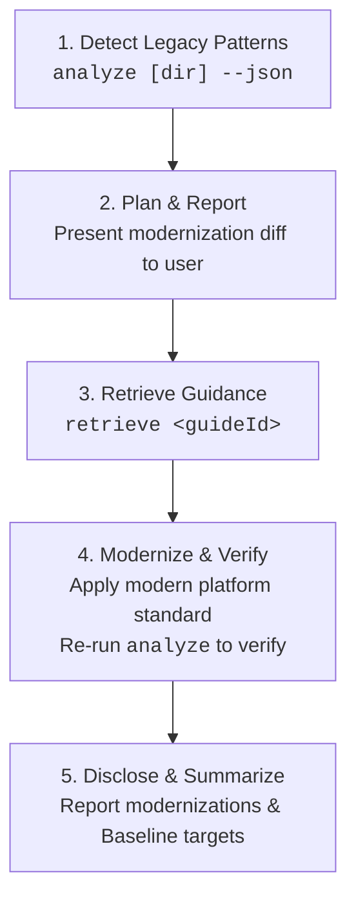
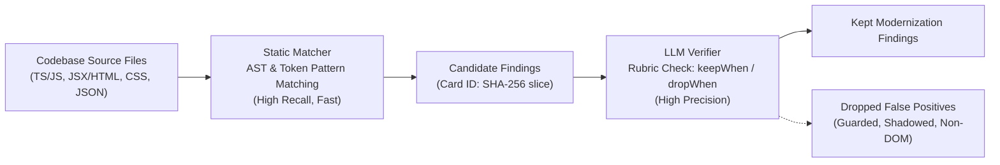

# Modern Web Guidance Analyzer (`src/analyzing`)

The Modern Web Guidance Analyzer scans brownfield web codebases for legacy idioms, obsolete polyfills, and userland workarounds, mapping every finding directly to a corresponding [Modern Web Guidance](../../guides) standard. It is designed for dual operation: fast, human-readable terminal reports for developers and structured machine-readable JSON for autonomous coding agents.

See [LEXICON.md](./LEXICON.md) for the canonical vocabulary (`Modernize`, `analyze`, `Guide Triage`, `Static Matcher`, `LLM Verifier`, `Detection Eval Judge`, `Update Eval`, and the `rule-writing` and `held-out` splits).

---

## 1. Quickstart

### Command-Line Interface

The analyzer can be run locally via the repository runner `gd` or in downstream projects via `npx`:

```bash
# In the modern-web-guidance repository:
node bin/gd.ts analyze [path/to/project] [options]

# In any brownfield project via npx:
npx -y modern-web-guidance@latest analyze [path/to/project] [options]
```

### CLI Options

| Flag | Type | Description |
| :--- | :--- | :--- |
| `[dir]` | Positional | Directory to analyze (defaults to current working directory). |
| `--json` | Flag | Output machine-readable JSON format for AI coding agents. |
| `--guide <guideId>` | String | Restrict analysis to a single guide ID (e.g. `--guide autofill-sign-in-form`). |
| `--tier <tier>` | String | Restrict analysis to a confidence tier (`qualified` or `experimental`). |
| `--experimental`, `--all-rules` | Flag | Run all 70 active feature guides (98 rules total in `ALL_RULES`), including experimental rules. |
| `-h, --help` | Flag | Display CLI usage information and exit. |

### Human-Readable Output Example

```text
Modern Web Guidance Analyzer: /workspace/my-app
Found 3 modernization opportunities across 2 guides:

* autofill-sign-in-form [qualified] (2 findings)
  Summary: Use standard autocomplete attributes on username and password inputs instead of custom credentials handling.
  Retrieve: npx -y modern-web-guidance@latest retrieve "autofill-sign-in-form"
  Findings:
    - src/components/Login.tsx:42: Missing autocomplete="username" or autocomplete="current-password" on credential input
    - src/views/Register.vue:18: Input with type="password" lacks autocomplete attribute

* animate-element-entry-exit [qualified] (1 finding)
  Summary: Modernize imperative animation toggles and display none timing with CSS @starting-style and transition-behavior: allow-discrete.
  Retrieve: npx -y modern-web-guidance@latest retrieve "animate-element-entry-exit"
  Findings:
    - src/components/Toast.tsx:75: Imperative transitionend listener setting display none; replace with @starting-style
```

### Structured JSON Output (`--json`)

Coding agents receive structured JSON containing exact file coordinates, confidence tiers, message descriptions, and copy-paste retrieval commands:

```json
{
  "targetDir": "/workspace/my-app",
  "totalFindings": 1,
  "guides": [
    {
      "guideId": "autofill-sign-in-form",
      "tier": "qualified",
      "summary": "Use standard autocomplete attributes on username and password inputs.",
      "retrieveCommand": "npx -y modern-web-guidance@latest retrieve \"autofill-sign-in-form\"",
      "count": 1,
      "findings": [
        {
          "ruleId": "autofill-sign-in-form",
          "file": "src/components/Login.tsx",
          "line": 42,
          "message": "Missing autocomplete on login form credentials input",
          "codeSnippet": "<input type=\"password\" name=\"pass\" />"
        }
      ]
    }
  ]
}
```

---

## 2. Modernize Workflow (`D-013`)

For autonomous AI coding agents (Claude Code, Jetski, Codex), modernizing existing code follows the **Modernize** workflow. The `analyze` subcommand serves as the detection step—finding legacy patterns and stopping there—while the agent carries out the planning, guidance retrieval, modern standard application, and verification:



1. **Detect Legacy Patterns (`analyze`)**: Execute `npx modern-web-guidance analyze <dir> --json` to detect candidate modernization targets across the project. `analyze` finds legacy patterns and stops there.
2. **Plan & Confirm**: Group detected findings by `guideId`, inspect source contexts against the verification rubric (`keepWhen`/`dropWhen`), and report a clear modernization proposal to the developer before editing code.
3. **Retrieve Guidance**: For each approved guide ID, run `npx modern-web-guidance retrieve "<guideId>"` to fetch the complete canonical guidance, including edge cases, accessibility invariants, and fallback strategies.
4. **Modernize & Verify**: Update legacy code to standard web platform features (e.g. native `<dialog>`, `content-visibility`, `autocomplete`). Re-run `analyze <dir> --json` to verify that findings are eliminated without regressions.
5. **Disclose & Summarize**: End the turn with a concise summary describing the modernized APIs and any browser Baseline implications.

---

## 3. Architecture: Static Matcher + LLM Verifier

High-precision static analysis requires balancing high recall against near-zero false positive rates across diverse real-world frameworks. The analyzer achieves this through a two-step runtime architecture:



### Static Matcher (High-Recall Deterministic Scanner)

- **Speed & Breadth**: Scans thousands of files in milliseconds using token pre-filters (`fastTokens`) before parsing ASTs.
- **Multi-Modal Matchers**: Evaluates JavaScript/TypeScript syntax trees via `ts-morph`, DOM elements and JSX props via custom AST visitors, CSS stylesheets via declaration parsing, and package dependencies via `package.json`.
- **Finding Identity**: Every finding receives a deterministic 12-character hex ID:
  $$\text{CardID} = \text{SHA256}(\text{repo} : \text{commit} : \text{guideId} : \text{file} : \text{line})[0..12]$$
  This guarantees stable tracking across repeat runs and evaluation datasets.

### LLM Verifier (Contextual Rubric Filter)

Candidate matches are validated against rule-specific rubrics defined in [`schema.ts`](./schema.ts):
- **`keepWhen` Criteria**: Verified when the candidate matches genuine legacy workarounds (e.g., custom event loops, manual clipboard workarounds, DIY popover positioning).
- **`dropWhen` Criteria**: Immediately discards false positives, including:
  - Code already guarded by feature detection (`'showPicker' in HTMLInputElement.prototype`).
  - Identifiers shadowed in unrelated scopes (e.g., local variables named `dialog` in audio or physics engines).
  - Out-of-domain contexts (WebGL canvas contexts, Node.js CLI tools).

---

## 4. Rule Authoring (`AnalyzerRule`)

Each analyzer rule implements the `AnalyzerRule` interface from [`schema.ts`](./schema.ts):

```typescript
export interface AnalyzerRule {
  readonly id: string;
  readonly guideId: string;
  readonly guideHash: string;
  readonly summary: string;
  readonly matcher: RuleMatcher;
  readonly verifierRubric: VerifierRubric;
}
```

### Supported Matcher Kinds

1. **`JsRuleMatcher` (`kind: 'js'`):** Analyzes JavaScript and TypeScript files using `ts-morph` AST navigation.
2. **`DomRuleMatcher` (`kind: 'dom'`):** Inspects HTML templates and JSX/TSX elements for tag names, attribute combinations, and missing modern platform attributes.
3. **`CssRuleMatcher` (`kind: 'css'`):** Checks CSS rules and style declarations for obsolete workarounds (e.g. manual `-webkit-line-clamp` fallbacks).
4. **`DependencyRuleMatcher` (`kind: 'dependency'`):** Flags obsolete third-party npm packages whose functionality has been superseded by native web platform APIs.

### Example Rule Implementation

```typescript
import type { AnalyzerRule, DomRuleMatcher } from '../schema.ts';

const matcher: DomRuleMatcher = {
  kind: 'dom',
  selector: 'input',
  fastTokens: ['type="password"', "type='password'"],
  matchElement(element) {
    const type = element.getAttribute('type');
    if (type !== 'password') return null;

    const hasAutocomplete = element.hasAttribute('autocomplete');
    if (hasAutocomplete) return null;

    return {
      message: 'Password input lacks standard autocomplete attribute; modern password managers require autocomplete="current-password" or autocomplete="new-password".',
    };
  },
};

export const autofillSignInFormRule: AnalyzerRule = {
  id: 'autofill-sign-in-form',
  guideId: 'autofill-sign-in-form',
  guideHash: 'a1b2c3d4e5f6',
  summary: 'Add standard autocomplete attributes to sign-in and registration form inputs.',
  matcher,
  verifierRubric: {
    keepWhen: [
      'Input element has type="password" without an autocomplete attribute.',
      'Input element accepts credential data inside an authentication or registration form.',
    ],
    dropWhen: [
      'Element already defines autocomplete="current-password" or autocomplete="new-password".',
      'Element is an internal mock, unit test fixture, or non-credential token input.',
    ],
  },
};
```

### Qualified Rules & Gated Execution

To guarantee zero hallucinated false alarms when run in interactive developer terminals, the analyzer enforces strict gating:
- **`QUALIFIED_RULES` (`QUALIFIED_GUIDE_IDS`):** By default in standard terminal CLI mode and `--json` mode, the analyzer runs rules for guides that clear objective qualification criteria (70 active guides: 37 qualified across 53 rules, and 33 experimental across 45 rules, totaling 98 rules in `ALL_RULES`). In `--json` mode, complete `verifierRubric` definitions (`keepWhen` and `dropWhen`) are emitted so coding agents can perform runtime verification before proposing edits.
- **`ALL_RULES` (`--experimental` / `--all-rules`):** Executes all 70 active feature guides across 98 rules in `ALL_RULES`, including experimental rules.

### 3-Tier Qualification Criteria

Rules qualify for default terminal shipping under a 3-tier hierarchy:
- **Tier A (Human Ground Truth $\ge 90\%$):** Rules validated by direct blind human spot-check decks on the `held-out` split achieving $\ge 90\%$ precision.
- **Tier B (Detection Eval Consensus $\ge 90\%$ at $n \ge 35$):** Rules where 3-run majority-vote Detection Eval Judge consensus reaches $\ge 90\%$ across at least 35 candidate findings on the `held-out` split with Wilson 95% CI lower bound $\ge 0.85$.
- **Tier C (Structural / Low Misfire $\le 10\%$):** Rules with deterministic syntactic markers (e.g. `package.json` dependencies, vendored library replacements, unambiguous web platform APIs) exhibiting low structural misfire rates ($\le 10\%$).

### 2-Axis Triage Taxonomy

Every web platform standard in the catalog is classified across two orthogonal axes:
- **Axis 1: Detectability / Feasibility:**
  - `detectable`: Deterministic structural AST/DOM/CSS/dependency pattern with high signal-to-noise ratio.
  - `not-detectable`: Visual, behavioural, or conceptual change without a distinguishable legacy syntax footprint.
  - `hard-not-recommended`: High ambiguity or overwhelming userland idiom collision.
- **Axis 2: Scope & Architecture:**
  - `1-to-1-replacement`: Direct, self-contained API substitution (e.g., CSS `text-wrap: balance`, `scrollbar-color`, `autocomplete`).
  - `ui-recipe-multi-part`: Multi-component orchestrations (dialog + backdrop + escape listener) requiring compound matching.
  - `library-superseded`: Third-party npm package or vendored script superseded by native standard.

### Qualified Feature Guides (37 Qualified Guides across 53 Rules)

| # | Guide ID | Matcher Kind | Qualification Tier | Modern Platform Target |
| :- | :--- | :--- | :--- | :--- |
| 1 | `animate-element-entry-exit` | CSS | Tier A | `@starting-style` and `transition-behavior: allow-discrete` |
| 2 | `animate-to-intrinsic-sizes` | CSS | Tier B | `calc-size()` and `interpolate-size: allow-keywords` |
| 3 | `atrule-support-conditionals` | CSS | Tier C | `@supports at-rule(@...)` |
| 4 | `autofill-address-form` | DOM | Tier B | Standard `autocomplete` attributes on address form inputs |
| 5 | `autofill-sign-in-form` | DOM | Tier A | Standard `autocomplete="username"` and `autocomplete="current-password"` |
| 6 | `branded-select-styling` | CSS | Tier B | Customizable native `<select>` with `appearance: base-select` |
| 7 | `calculate-event-differentials` | JS | Tier B | Temporal API (`Temporal.PlainDate` / `Temporal.Instant`) |
| 8 | `capture-location-agnostic-data` | JS | Tier C | Native `Intl.DisplayNames` and location-agnostic `Temporal` types |
| 9 | `checkbox` | CSS | Tier A | CSS `accent-color` for styled checkboxes |
| 10 | `custom-text-decorations` | CSS | Tier C | CSS `text-decoration-thickness`, `text-underline-offset`, `text-decoration-color` |
| 11 | `customize-scrollbar-color-and-thickness` | CSS | Tier A | Standard CSS `scrollbar-color` and `scrollbar-width` |
| 12 | `dark-mode` | CSS | Tier B | CSS `color-scheme: light dark` and `light-dark()` color functions |
| 13 | `deliver-optimized-decorative-images` | CSS | Tier A | CSS `image-set()` resolution and format negotiation |
| 14 | `drag` | DOM | Tier C | Native HTML Drag and Drop standards |
| 15 | `equal-width-text-lines` | CSS | Tier B | CSS `text-wrap: balance` and text sizing |
| 16 | `export-html-media-from-canvas` | JS | Tier C | Canvas captureStream and MediaRecorder standards |
| 17 | `form-fields-automatically-fit-contents` | CSS | Tier B | CSS `field-sizing: content` |
| 18 | `highlight-text-ranges` | JS | Tier C | CSS Custom Highlight API (`CSS.highlights` and `::highlight()`) |
| 19 | `improve-next-page-load-performance` | DOM | Tier C | Declarative Speculation Rules API (`<script type="speculationrules">`) |
| 20 | `improve-text-layout-and-legibility` | CSS | Tier C | CSS `text-wrap: pretty` and `text-wrap: balance` |
| 21 | `individual-transform-properties` | CSS | Tier A | Individual transform properties (`rotate`, `scale`, `translate`) |
| 22 | `interactions-in-complex-layouts` | CSS | Tier C | CSS subgrid and container query layouts |
| 23 | `language-detection` | JS | Tier C | Built-in browser `LanguageDetector` API |
| 24 | `light-dismiss-a-dialog` | DOM | Tier B | Native `<dialog closedby="any">` |
| 25 | `platform-controls-dismiss-dialog` | DOM | Tier C | Built-in dialog dismiss controls (`command="close"`) |
| 26 | `prevent-page-scroll-under-modal-dialog` | CSS | Tier B | Native `<dialog>` and CSS `overscroll-behavior: contain` |
| 27 | `responsive-table` | CSS | Tier A | CSS Container Queries (`@container`) and sticky headers |
| 28 | `sanitize-untrusted-html` | JS | Tier B | Native `Sanitizer` API and `setHTML()` |
| 29 | `scroll-entry-exit-effects` | CSS | Tier C | CSS Scroll-Driven Animations (`animation-timeline: view()`) |
| 30 | `scroll-position-aware-elements` | CSS | Tier B | CSS Scroll-Driven Animations (`animation-timeline: scroll()`) |
| 31 | `scroll-progress-indicator` | CSS | Tier C | CSS Scroll-Driven Animations scroll progress |
| 32 | `scrollspy` | CSS | Tier B | CSS `scroll-target-group: auto` and `:target-current` |
| 33 | `soft-edge-content-fade` | CSS | Tier C | CSS `mask-image: linear-gradient(...)` |
| 34 | `state-aware-sticky-headers` | CSS | Tier C | CSS `position: sticky` and scroll-driven state detection |
| 35 | `styling-web-components` | CSS | Tier C | CSS `::part()`, `adoptedStyleSheets`, and modern shadow DOM styling |
| 36 | `support-global-calendar-systems` | JS | Tier C | Native `Temporal.PlainDate.prototype.withCalendar()` and `Intl.DateTimeFormat` |
| 37 | `switch` | DOM | Tier C | Native HTML `<input type="checkbox" switch>` |

---

## 5. Evaluation, Update Eval & Measurement Framework

The analyzer adheres to statistical rigor to guarantee production accuracy before any rule is published in `QUALIFIED_RULES`.

### Evaluation Subsystem (`src/analyzing/eval/`)

- **`guide-triage.ts`**: Implements the 2-axis triage taxonomy (`detectable`, `1-to-1-replacement`, etc.) and maintains canonical metadata for all web platform guides.
- **`detection-eval.ts`**: Runs multi-pass LLM judge evaluation (`gemini-3.8-flash`) against human-graded cards (`grades.jsonl`) to measure true-positive and false-positive rates with majority voting.
- **`llm-verifier.ts`**: Implements the runtime and eval-time LLM verifier evaluating candidate matches against `verifierRubric` (`keepWhen` / `dropWhen`) specifications.
- **`update-eval.ts`**: Automated patch validation harness testing candidate modernization updates across 3 classes of bad patches (`no-op`, `deletion-gutting`, `broken/evasion`) and reference good fixes.
- **`stats.ts`**: Statistical foundations implementing Wilson binomial confidence intervals, sequential stopping decisions, and TPR/TNR metrics.
- **`prompts.ts`**: Centralized prompt templates, thinking budgets, and content-hashed version tracking across all LLM evaluation passes.

### 2-Split Corpus Architecture (`rule-writing` vs `held-out`)

The evaluation corpus is divided into two strictly isolated splits:
- **`rule-writing` (208 local repos in `analyzer-internal/repos.json` + 7,048 GitMirror files across 5,320 repos):** Used freely by engineers and agents to discover legacy patterns, author Static Matcher AST patterns, and tune LLM Verifier rubrics.
- **`held-out` (7,137 remote GitMirror files across 5,258 repos, `MOD(ABS(FARM_FINGERPRINT(repository)), 2) = 1`):** Reserved strictly for out-of-sample precision and recall validation (`scorecard.ts`). Never inspected when authoring or debugging rules, guaranteeing zero tuning leakage.

Cross-split boundary isolation is statically verified by internal audit tooling.

### Update Eval

To evaluate end-to-end code modernization without falling into the "Deletion Equals Resolution" trap (`G12`), **Update Eval** (`update-eval.ts`) enforces three static checks on every candidate modernization update:
- **Check 1 (Finding Eliminated Check):** Splices the patched window into the full file and verifies `0` remaining findings in the window and reduced full-file finding count.
- **Check 2 (Modern Syntax & Anti-Gutting Check):** Verifies clean AST/DOM/CSS parsing (`ts-morph` with JSX support, `linkedom`, `cssomnom`), top-level export retention, and comment-stripped presence of the guide's positive modern web feature.
- **Check 3 (Behavioral Check):** Runs behavioral/test assertions when available.
- **Verified Benchmarks:** **100.0% (`75/75`) rejection** on the 3-class seeded bad-patch sensitivity suite (`no-op`, `deletion-gutting`, `broken/evasion`), **100.0% (`25/25`) acceptance** on reference good fixes, and **90.0% (`36/40`, 95% CI `[76.9% – 96.0%]`)** static pass rate across findings from 25 guides.

### Running Evaluation Benchmarks

```bash
# Run unit tests across analyzing subsystem:
node --test "src/analyzing/**/*.test.ts"

# Run preflight verification (build, typecheck, lint):
pnpm run preflight

# Run Detection Eval Judge benchmark on evaluation decks:
node --env-file=.env src/analyzing/eval/detection-eval.ts

# Run 75-patch sensitivity suite & end-to-end agentic update evaluation:
node --env-file=.env src/analyzing/eval/update-eval.ts
```

All scorecard results and audit trails are logged to `PROGRESS.md` and serialized in `analyzer-internal/findings/`.

---

## 6. Contributor Playbook: How to Add & Qualify an Analyzer Rule

Follow this 4-step workflow to author, test, and qualify a rule for modern web guidance:

### Step 1: Guide Triage
1. **Verify Guide Triage status**: Ensure the feature guide is categorized as `detectable` (not `ui-recipe-multi-part` or `skip-no-old-way`).
2. **Record the Guide Triage entry**: Identify concrete 1-to-1 legacy APIs, CSS workarounds, or npm packages that the modern platform feature directly replaces (`replaces`), alongside lookalike patterns that are out of scope (`doesNotReplace`).
3. **Ground in real code**: Inspect only the `rule-writing` corpus (`208` local repos + `7,048` GitMirror files). Never inspect held-out code.

### Step 2: Static Matcher Authoring
1. **Choose matcher kind**: `JsRuleMatcher` (AST via `ts-morph`), `DomRuleMatcher` (HTML/JSX DOM via `linkedom`), `CssRuleMatcher` (CSS via `cssomnom`), or `DependencyRuleMatcher` (`package.json`).
2. **Implement in `src/analyzing/rules/<guide-id>.ts`**:
   - Set `fastTokens` pre-filters to ensure fast string pre-screening.
   - Target high recall on the structural shape of the legacy idiom.
   - Return clean finding messages explaining the modern replacement.
3. **Add unit test suite in `src/analyzing/rules/<guide-id>.test.ts`**: Test positive examples, negative examples, and edge cases.

### Step 3: LLM Verifier Rubric
1. **Define `verifierRubric` in the rule definition**:
   - `keepWhen`: Precise criteria matching genuine legacy workarounds.
   - `dropWhen`: Immediate exclusions (feature detection guards, shadowed variables, out-of-domain contexts).
2. **Agentic verification**: Ensure that `--json` output emits the complete rubric so AI coding agents can verify findings before proposing modernizations.

### Step 4: Held-Out Qualification
1. **Run preflight checks**: `pnpm run check:analyze` and `node --test "src/analyzing/**/*.test.ts"`.
2. **Run detection and update evaluation**: `node --env-file=.env src/analyzing/eval/update-eval.ts` and `node --env-file=.env src/analyzing/eval/detection-eval.ts`.
3. **Qualification criteria**:
   - **Experimental Rule**: Active in `ALL_RULES`, available under `--experimental` / `--all-rules`.
   - **Qualified Rule**: Promoted to `QUALIFIED_GUIDE_IDS` for default terminal shipping once it reaches $n \ge 35$ evaluated findings on the untuned `held-out` split and clears Wilson 95% CI lower bound $\ge 0.90$.
