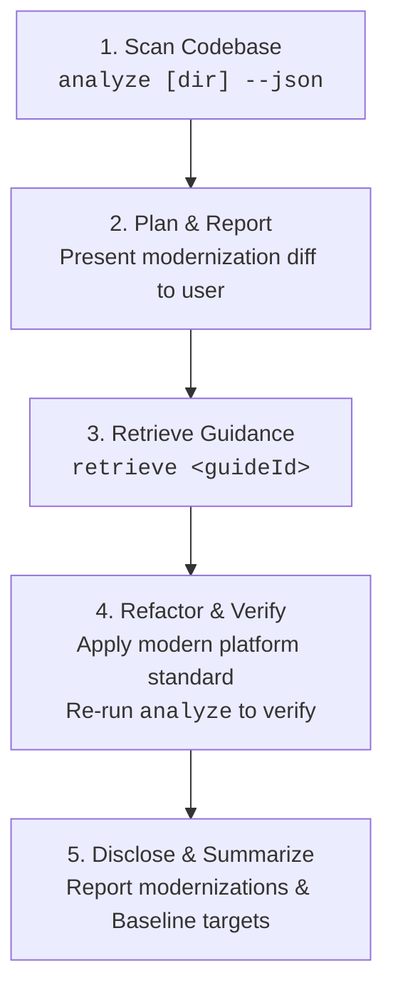
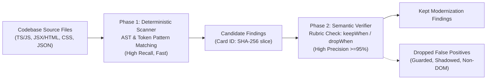

# Modern Web Guidance Analyzer (`src/analyzing`)

The Modern Web Guidance Analyzer scans brownfield web codebases for legacy idioms, obsolete polyfills, and userland workarounds, mapping every finding directly to a corresponding [Modern Web Guidance](../../guides) standard. It is designed for dual operation: fast, human-readable terminal reports for developers and structured machine-readable JSON for autonomous coding agents.

---

## 1. Quickstart

### Command-Line Interface

The analyzer can be run locally via the repository runner `gd` or in downstream projects via `npx`:

```bash
# In the modern-web-guidance repository:
node bin/gd.ts analyze [path/to/project] [options]

# In any brownfield project via npx:
npx -y modern-web-guidance@latest analyze [path/to/project] [options]
```

### CLI Options

| Flag | Type | Description |
| :--- | :--- | :--- |
| `[dir]` | Positional | Directory to analyze (defaults to current working directory). |
| `--json` | Flag | Output machine-readable JSON format for AI coding agents. |
| `--guide <guideId>` | String | Restrict analysis to a single guide ID (e.g. `--guide autofill-sign-in-form`). |
| `--tier=1`, `--proven-only` | Flag | Restrict analysis strictly to proven Tier 1 rules. |
| `--all-rules`, `--experimental` | Flag | Run all 35 landed feature guides (48 rules total in `ALL_RULES`), including experimental and unmeasured rules. |
| `-h, --help` | Flag | Display CLI usage information and exit. |

### Human-Readable Output Example

```text
Modern Web Guidance Analyzer: /workspace/my-app
Found 3 modernization opportunities across 2 guides:

* autofill-sign-in-form [tier-1] (2 findings)
  Summary: Use standard autocomplete attributes on username and password inputs instead of custom credentials handling.
  Retrieve: npx -y modern-web-guidance@latest retrieve "autofill-sign-in-form"
  Findings:
    - src/components/Login.tsx:42: Missing autocomplete="username" or autocomplete="current-password" on credential input
    - src/views/Register.vue:18: Input with type="password" lacks autocomplete attribute

* animate-element-entry-exit [tier-1] (1 finding)
  Summary: Modernize imperative animation toggles and display none timing with CSS @starting-style and transition-behavior: allow-discrete.
  Retrieve: npx -y modern-web-guidance@latest retrieve "animate-element-entry-exit"
  Findings:
    - src/components/Toast.tsx:75: Imperative transitionend listener setting display none; replace with @starting-style
```

### Structured JSON Output (`--json`)

Coding agents receive structured JSON containing exact file coordinates, confidence tiers, message descriptions, and copy-paste retrieval commands:

```json
{
  "targetDir": "/workspace/my-app",
  "totalFindings": 1,
  "guides": [
    {
      "guideId": "autofill-sign-in-form",
      "tier": "tier-1-proven",
      "summary": "Use standard autocomplete attributes on username and password inputs.",
      "retrieveCommand": "npx -y modern-web-guidance@latest retrieve \"autofill-sign-in-form\"",
      "count": 1,
      "findings": [
        {
          "ruleId": "autofill-sign-in-form",
          "file": "src/components/Login.tsx",
          "line": 42,
          "message": "Missing autocomplete on login form credentials input",
          "codeSnippet": "<input type=\"password\" name=\"pass\" />"
        }
      ]
    }
  ]
}
```

---

## 2. Agentic Workflow Loop (`D-013`)

For autonomous AI coding agents (Claude Code, Jetski, Codex), the analyzer operates in a tightly scoped 5-phase loop:



1. **Scan Codebase**: Execute `npx modern-web-guidance analyze <dir> --json` to detect candidate modernization targets across the project.
2. **Plan & Confirm**: Group detected findings by `guideId`, inspect source contexts, and report a clear migration proposal to the developer before editing code.
3. **Retrieve Guidance**: For each approved guide ID, run `npx modern-web-guidance retrieve "<guideId>"` to fetch the complete canonical guidance, including edge cases, accessibility invariants, and fallback strategies.
4. **Refactor & Re-verify**: Update legacy code to standard web platform features (e.g. native `<dialog>`, `content-visibility`, `autocomplete`). Re-run `analyze <dir> --json` to verify that findings are eliminated without regressions.
5. **Disclose & Summarize**: End the turn with a concise summary describing the modernized APIs and any browser Baseline implications.

---

## 3. Two-Phase Architecture

High-precision static analysis requires balancing high recall against near-zero false positive rates across diverse real-world frameworks. The analyzer achieves this through a two-phase architecture:



### Phase 1: High-Recall Deterministic Scanner

- **Speed & Breadth**: Scans thousands of files in milliseconds using token pre-filters (`fastTokens`) before parsing ASTs.
- **Multi-Modal Matchers**: Evaluates JavaScript/TypeScript syntax trees via `ts-morph`, DOM elements and JSX props via custom AST visitors, CSS stylesheets via declaration parsing, and package dependencies via `package.json`.
- **Finding Identity**: Every finding receives a deterministic 12-character hex ID:
  $$\text{CardID} = \text{SHA256}(\text{repo} : \text{commit} : \text{guideId} : \text{file} : \text{line})[0..12]$$
  This guarantees stable tracking across repeat runs and held-out evaluation datasets.

### Phase 2: High-Precision Semantic Verifier

Candidate matches are validated against rule-specific rubrics defined in [`schema.ts`](file:///usr/local/google/home/paulirish/code/guidance/src/analyzing/schema.ts):
- **`keepWhen` Criteria**: Verified when the candidate matches genuine legacy workarounds (e.g., custom event loops, manual clipboard workarounds, DIY popover positioning).
- **`dropWhen` Criteria**: Immediately discards false positives, including:
  - Code already guarded by feature detection (`'showPicker' in HTMLInputElement.prototype`).
  - Identifiers shadowed in unrelated scopes (e.g., local variables named `dialog` in audio or physics engines).
  - Out-of-domain contexts (WebGL canvas contexts, Node.js CLI tools).

---

## 4. Rule Authoring (`AnalyzerRule`)

Each analyzer rule implements the `AnalyzerRule` interface from [`schema.ts`](file:///usr/local/google/home/paulirish/code/guidance/src/analyzing/schema.ts):

```typescript
export interface AnalyzerRule {
  readonly id: string;
  readonly guideId: string;
  readonly guideHash: string;
  readonly summary: string;
  readonly matcher: RuleMatcher;
  readonly phase2Rubric: Phase2Rubric;
}
```

### Supported Matcher Kinds

1. **`JsRuleMatcher` (`kind: 'js'`):** Analyzes JavaScript and TypeScript files using `ts-morph` AST navigation.
2. **`DomRuleMatcher` (`kind: 'dom'`):** Inspects HTML templates and JSX/TSX elements for tag names, attribute combinations, and missing modern platform attributes.
3. **`CssRuleMatcher` (`kind: 'css'`):** Checks CSS rules and style declarations for obsolete workarounds (e.g. manual `-webkit-line-clamp` fallbacks).
4. **`DependencyRuleMatcher` (`kind: 'dependency'`):** Flags obsolete third-party npm packages whose functionality has been superseded by native web platform APIs.

### Example Rule Implementation

```typescript
import type { AnalyzerRule, DomRuleMatcher } from '../schema.ts';

const matcher: DomRuleMatcher = {
  kind: 'dom',
  selector: 'input',
  fastTokens: ['type="password"', "type='password'"],
  matchElement(element) {
    const type = element.getAttribute('type');
    if (type !== 'password') return null;

    const hasAutocomplete = element.hasAttribute('autocomplete');
    if (hasAutocomplete) return null;

    return {
      message: 'Password input lacks standard autocomplete attribute; modern password managers require autocomplete="current-password" or autocomplete="new-password".',
    };
  },
};

export const autofillSignInFormRule: AnalyzerRule = {
  id: 'autofill-sign-in-form',
  guideId: 'autofill-sign-in-form',
  guideHash: 'a1b2c3d4e5f6',
  summary: 'Add standard autocomplete attributes to sign-in and registration form inputs.',
  matcher,
  phase2Rubric: {
    keepWhen: [
      'Input element has type="password" without an autocomplete attribute.',
      'Input element accepts credential data inside an authentication or registration form.',
    ],
    dropWhen: [
      'Element already defines autocomplete="current-password" or autocomplete="new-password".',
      'Element is an internal mock, unit test fixture, or non-credential token input.',
    ],
  },
};
```

### Qualified Rules & Gated Execution (`R33`)

To guarantee zero hallucinated false alarms when run in interactive developer terminals, the analyzer enforces strict gating:
- **`TERMINAL_QUALIFIED_RULES`:** In standard terminal CLI mode, the analyzer runs **deterministic Phase 1 only** for guides that clear the statistical held-out qualification bar (`TERMINAL_QUALIFIED_GUIDE_IDS`). Currently, `animate-element-entry-exit` is qualified on held-out repositories (`97.5%` precision, 95% CI `[91.2% - 99.3%]`).
- **`JSON_QUALIFIED_RULES`:** In `--json` mode for AI coding agents, the analyzer runs `JSON_QUALIFIED_GUIDE_IDS` and emits complete `phase2Rubric` definitions (`keepWhen` and `dropWhen`) so autonomous agents can verify candidate findings before proposing edits.
- **`ALL_RULES` (`--all-rules` / `--experimental`):** Executes all 35 landed feature guides across 48 rules, enabling research and broader scanning.

### Registered Feature Guides (35 Guides, 48 Rules in `ALL_RULES`)

| # | Guide ID | Tier | Held-Out Tune Prec (`local-93`) | Untuned Final Prec (`gitmirror`) | Modern Platform Target |
| :- | :--- | :--- | :--- | :--- | :--- |
| 1 | `animate-element-entry-exit` | **Qualified (`proven-high-n`)** | `77/79 = 97.5%` (95% CI `[91.2% - 99.3%]`) | `46/58 = 79.3%` | `@starting-style` and `transition-behavior: allow-discrete` |
| 2 | `individual-transform-properties` | Proven High-$n$ (Final) | `58/68 = 85.3%` | `94/95 = 99.0%` (95% CI `[94.3% - 99.8%]`) | Individual transform properties (`rotate`, `scale`, `translate`) |
| 3 | `autofill-sign-in-form` | Unmeasured Low-$n$ | `23/23 = 100.0%` | `68/75 = 90.7%` | Standard `autocomplete="username"` and `autocomplete="current-password"` |
| 4 | `animate-to-intrinsic-sizes` | Unmeasured Low-$n$ | `4/4 = 100.0%` | `12/13 = 92.3%` | `calc-size()` and `interpolate-size: allow-keywords` |
| 5 | `declarative-dialog-popover-control` | Experimental (Tuned) | `27/33 = 81.8%` | `57/73 = 78.1%` | Declarative `commandfor` / `command` and `popovertarget` |
| 6 | `coordinate-global-events` | Experimental | `3/4 = 75.0%` | `17/19 = 89.5%` | `Temporal.ZonedDateTime` for global timezone events |
| 7 | `customize-scrollbar-color-and-thickness` | Experimental | `22/29 = 75.9%` | `88/97 = 90.7%` | Standard CSS `scrollbar-color` and `scrollbar-width` |
| 8 | `child-state-based-styling` | Experimental | `2/13 = 15.4%` | `3/31 = 9.7%` | CSS `:has()` relational pseudo-class |
| 9 | `accessible-error-announcement` | Experimental | `3/4 = 75.0%` | `25/28 = 89.3%` | `:user-invalid` and `aria-live="polite"` / `role="alert"` |
| 10 | `break-up-long-tasks` | Unmeasured Low-$n$ | `1/1 = 100.0%` | `0/1 = 0.0%` | `scheduler.yield()` and `scheduler.postTask()` |
| 11 | `ime-safe-enter-submit` | Unmeasured Low-$n$ | `1/1 = 100.0%` | `9/9 = 100.0%` | `e.isComposing` guard on Enter keydown handlers |
| 12 | `stack-drill-down` | Experimental | `0/1 = 0.0%` | `0/0 = N/A` | Native HTML `inert` attribute on inactive drill-down panels |
| 13 | `calculate-event-differentials` | Unmeasured Low-$n$ (Tuned) | `1/1 = 100.0%` | `10/13 = 76.9%` | Temporal API (`Temporal.PlainDate` / `Temporal.Instant`) |
| 14 | `resilient-context-menus-and-nested-dropdowns` | Experimental | `26/29 = 89.7%` | `36/57 = 63.2%` | Native `popover` and CSS Anchor Positioning |
| 15 | `form-fields-automatically-fit-contents` | Unmeasured Low-$n$ | `2/2 = 100.0%` | `12/12 = 100.0%` | CSS `field-sizing: content` |
| 16 | `brand-consistent-forms` | Experimental | `2/7 = 28.6%` | `30/57 = 52.6%` | CSS `accent-color` for custom form controls |
| 17 | `scrollspy` | Experimental | `0/0 = N/A` | `40/53 = 75.5%` | CSS `scroll-target-group: auto` and `:target-current` |
| 18 | `autofill-address-form` | Unmeasured Low-$n$ | `1/1 = 100.0%` | `1/1 = 100.0%` | Standard `autocomplete` attributes on address form inputs |
| 19 | `shadow-dom` | Experimental | `12/25 = 48.0%` | `12/25 = 48.0%` | Native `<template>` and Declarative Shadow DOM |
| 20 | `branded-select-styling` | Experimental | `3/7 = 42.9%` | `11/17 = 64.7%` | Customizable native `<select>` with `appearance: base-select` |
| 21 | `adapt-scrollbar-to-contrast-preferences` | Experimental | `0/1 = 0.0%` | `0/15 = 0.0%` | `scrollbar-color`, `scrollbar-width`, and `prefers-contrast` |
| 22 | `checkbox` | Unmeasured Low-$n$ (Tuned) | `5/5 = 100.0%` | `32/35 = 91.4%` | CSS `accent-color` for styled checkboxes |
| 23 | `size-aware-styling` | Experimental | `0/0 = N/A` | `0/0 = N/A` | Native CSS Container Queries (`@container`) |
| 24 | `defer-work-until-scroll-ends` | Experimental | `0/0 = N/A` | `9/11 = 81.8%` | Native `scrollend` event listener |
| 25 | `detect-initial-visibility-state` | Experimental | `0/6 = 0.0%` | `0/6 = 0.0%` | `PerformanceNavigationTiming` / `visibility-state` entries |
| 26 | `schedule-tasks-by-priority` | Unmeasured Low-$n$ | `1/1 = 100.0%` | `2/2 = 100.0%` | Prioritized task scheduling via `scheduler.postTask()` |
| 27 | `prevent-page-scroll-under-modal-dialog` | Unmeasured Low-$n$ | `1/1 = 100.0%` | `5/8 = 62.5%` | Native `<dialog>` and CSS `overscroll-behavior: contain` |
| 28 | `dark-mode` | Experimental | `2/3 = 66.7%` | `35/54 = 64.8%` | CSS `color-scheme: light dark` and `light-dark()` color functions |
| 29 | `manage-recurring-intervals` | Experimental (Tuned) | `3/4 = 75.0%` | `5/12 = 41.7%` | Temporal API (`Temporal.PlainDate.add` / `Temporal.Duration`) |
| 30 | `drag` | Experimental / Low-$n$ | `0/0 = N/A` | `1/1 = 100.0%` | Native HTML Drag and Drop standards |
| 31 | `format-human-readable-durations` | Unmeasured Low-$n$ | `7/7 = 100.0%` | `17/19 = 89.5%` | `Intl.DurationFormat` |
| 32 | `model-partial-time-concepts` | Experimental | `0/1 = 0.0%` | `0/26 = 0.0%` | Temporal API (`Temporal.PlainYearMonth` / `Temporal.PlainMonthDay`) |
| 33 | `sanitize-untrusted-html` | Unmeasured Low-$n$ | `2/2 = 100.0%` | `9/16 = 56.3%` | Native `Sanitizer` API and `setHTML()` |
| 34 | `custom-select-picker-layouts` | Experimental | `0/2 = 0.0%` | `0/11 = 0.0%` | `<select>` popover customization |
| 35 | `scroll-position-aware-elements` | Unmeasured Low-$n$ | `1/1 = 100.0%` | `9/16 = 56.3%` | CSS Scroll-Driven Animations (`animation-timeline: scroll()`) |

---

## 5. Evaluation, 3-Gate Fix Harness & Measurement Framework

The analyzer adheres to strict statistical rigor to guarantee production accuracy before any rule is published in `QUALIFIED_RULES`.

### 3-Way Split Architecture (`R23`, `O32`, `O60`)

The evaluation corpus is divided into three strictly isolated splits:
- **`rule-writing` (115 local repos):** Used exclusively for authoring Phase 1 AST patterns and Phase 2 rubrics.
- **`tune` (93 local held-out repos):** Used for threshold tuning, sequential sample analysis, and dev-set verification.
- **`final` (2,336 remote GitMirror repos, 2,713 files):** Untuned, unexamined test split used solely for final held-out validation.

Cross-split boundary isolation is statically verified by [`audit-transcripts.ts`](file:///usr/local/google/home/paulirish/code/guidance/src/analyzing/audit-transcripts.ts).

### Independent Judge Protocol & Honest Calibration

Evaluation uses a 3-run majority-vote `gemini-3.8-flash` judge ([`judge.ts`](file:///usr/local/google/home/paulirish/code/guidance/src/analyzing/judge.ts)) operating under a de-primed prompt (`gemini-3.8-flash:detective-v6-spec22-5af939ff`) with zero technique hints or pre-approvals:
- **Stability:** **87.7%** unanimous agreement across 3 passes at $T=0.2$.
- **Canary TNR:** **100.0%** (2/2 negative canary controls correctly rejected).
- **Admission Status:** In-sample dev evaluation yielded Gwet's $\mathrm{AC}_1 = 0.498$ and Krippendorff's $\alpha = -0.099$. Because $\alpha < 0.667$, the judge is labeled **`not admitted`** pending evaluation against Paul Irish's upcoming unseen admission deck.

### Dual Held-Out Scorecard Results (35 Guides)

1. **Local-93 `tune` Split (`845acda987f8`):**
   - **Pooled Held-Out Precision:** **78.5%** (`278/354`, 95% CI `[74.0% - 82.5%]`).
   - **Qualified Rule (`animate-element-entry-exit`):** **97.5%** (`77/79`, 95% CI `[91.2% - 99.3%]`).
   - **Coverage:** 1/35 guides clearing $\ge 0.90$ LB + 13 zero-FP low-$n$ guides.
   - **Held-Out Recall:** **60.4%** ($n=101$).
2. **GitMirror `final` Split (`d26557cf4124` across 2,336 repos):**
   - **Pooled Held-Out Precision:** **72.0%** (`695/966`, 95% CI `[69.0% - 74.7%]`).
   - **Qualified Rule (`individual-transform-properties`):** **98.9%** (`94/95`, 95% CI `[94.3% - 99.8%]`).
   - **Coverage:** 1/35 guides clearing $\ge 0.90$ LB + 5 zero-FP low-$n$ guides.
   - **Phase 1 Precision:** **53.0%** (`721/1359`). Phase 2 filter retained **966** findings with 26 false drops.

### 3-Gate Fix Validation Harness ([`fix-harness.ts`](file:///usr/local/google/home/paulirish/code/guidance/src/analyzing/fix-harness.ts))

To evaluate end-to-end agentic code modernization without falling into the "Deletion Equals Resolution" trap (`G12`), `fix-harness.ts` enforces three gates on every candidate refactor:
- **Gate 1 (Legacy Finding Eliminated):** Splices the patched window into the full file and verifies `0` remaining findings in the window and reduced full-file finding count.
- **Gate 2 (Syntax, Anti-Gutting & Comment-Stripped Modern Feature Check):** Verifies clean AST/DOM/CSS parsing (`ts-morph` with JSX support, `linkedom`, `cssomnom`), top-level export retention, and comment-stripped presence of the guide's positive modern web feature.
- **Gate 3 (Behavioral Invariants):** Runs behavioral/test assertions when available.
- **Verified Benchmarks:** **100.0% (`75/75`) rejection** on the 3-class seeded bad-patch sensitivity suite (`no-op`, `deletion-gutting`, `broken/evasion`), **100.0% (`25/25`) acceptance** on reference good fixes, and **90.0% (`36/40`, 95% CI `[76.9% – 96.0%]`)** end-to-end resolution across held-out findings from the 25 qualified guides.

### Running Evaluation Benchmarks

```bash
# Run unit tests across analyzing subsystem (565 tests across 58 suites):
node --test "src/analyzing/**/*.test.ts"

# Run preflight verification (typecheck, lint, ast-grep):
pnpm run check:analyze

# Generate held-out detection scorecard across the 93-repo corpus:
node --env-file=.env src/analyzing/pilot-scorecard.ts

# Run 75-patch sensitivity suite & end-to-end agentic fix evaluation:
node --env-file=.env src/analyzing/fix-harness.ts
```

All scorecard results and audit trails are logged to `PROGRESS.md` and serialized in `analyzer-internal/findings/`.
