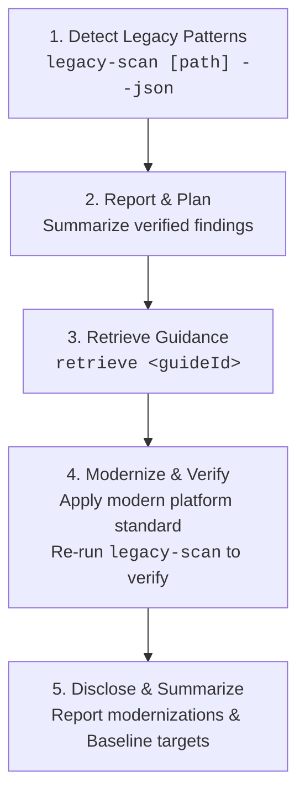
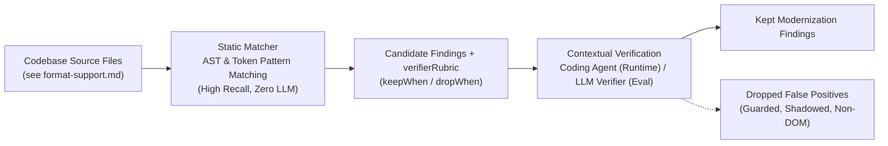

# Modern Web Guidance Analyzer (`src/analyzing`)

The Modern Web Guidance Analyzer scans brownfield web codebases for legacy idioms, obsolete polyfills, and userland workarounds, mapping every finding directly to a corresponding [Modern Web Guidance](../../guides) standard. It is designed for dual operation: fast, human-readable terminal reports for developers and structured machine-readable JSON for autonomous coding agents.

See [LEXICON.md](./LEXICON.md) for the canonical vocabulary (`Modernize`, `legacy-scan`, `Guide Triage`, `Static Matcher`, `LLM Verifier`, `Detection Eval Judge`, and the `rule-writing` and `held-out` splits).

See [format-support.md](./format-support.md) for which file formats and embedded languages `legacy-scan` reads, what "supported" promises, and how to propose a new format.

---

## 1. Quickstart

### Command-Line Interface

The analyzer can be run locally via the repository runner `gd` or in downstream projects via `npx`:

```bash
# In the modern-web-guidance repository:
node bin/gd.ts legacy-scan [path/to/project] [options]

# In any brownfield project via npx:
npx -y modern-web-guidance@latest legacy-scan [path/to/project] [options]
```

### CLI Options

| Flag | Type | Description |
| :--- | :--- | :--- |
| `[path]` | Positional | Directory or file to analyze (defaults to current working directory). |
| `--json` | Flag | Output machine-readable JSON format for AI coding agents. |
| `--guide <guideId>` | String | Restrict analysis to a single guide ID (e.g. `--guide autofill-sign-in-form`). |
| `--include-docs-and-tests` | Flag | Include documentation, example, demo, and test files (skipped by default). |
| `--skill-version <version>` | String | Passed by the bundled agent skill to report its version for update checks. Not meant for manual use. |
| `-h, --help` | Flag | Display CLI usage information and exit. |

### Human-Readable Output Example

```text
Modern Web Guidance Analyzer — /workspace/etherpad-lite
Found 4 modernization opportunities across 3 guides (scanned 37 guides with deterministic rules; ~20% of the guidance corpus):
Note: Static analysis results are provisional — verify against the Keep/Drop criteria below.
Skipped 53 docs and test files (pass --include-docs-and-tests to scan).

* autofill-sign-in-form (1 finding)
  Password input in sign-in or credential form should specify autocomplete="current-password" or autocomplete="new-password".
  Keep when: The password input is part of a user-facing authentication, current-password verification, or sign-in form; T…
  Drop when: The password input is disabled, readonly, hidden, or a non-interactive display widget; The password input alr…
  - src/templates/pad.html:109
    <input id='passwordinput' type='password' name='password'><input type='submit'…

* customize-scrollbar-color-and-thickness (2 findings)
  Vendor ::-webkit-scrollbar pseudo-elements customize or hide scrollbars; use standard scrollbar-color and scrollbar-width (including scrollbar-width: none) instead.
  Keep when: The CSS rule uses vendor pseudo-elements (::-webkit-scrollbar or ::-webkit-scrollbar-thumb) to customize scro…
  Drop when: The stylesheet already defines standard scrollbar-width or scrollbar-color properties; The rule only resets s…
  - src/static/skins/colibris/src/components/chat.css:49
    #chattext::-webkit-scrollbar {
  - src/static/skins/colibris/src/components/chat.css:53
    #chattext::-webkit-scrollbar-thumb {

* form-fields-automatically-fit-contents (1 finding)
  Imperative JavaScript auto-resizing of textareas and inputs using scrollHeight or autosize() should be replaced with CSS field-sizing: content.
  Keep when: A keyup, input, change, or keydown event listener dynamically recalculates a textarea or text input height/wi…
  Drop when: The code is guarded by a feature query checking CSS.supports("field-sizing", "content") or field-sizing suppo…
  - src/static/js/admin/settings.js:30
    $('.settings').autosize();

Retrieve a guide: npx modern-web-guidance retrieve <guide-id>
```

### Structured JSON Output (`--json`, abridged)

Coding agents receive structured JSON containing exact file coordinates, message descriptions, verification rubrics, and copy-paste retrieval commands:

```json
{
  "targetDir": "/workspace/etherpad-lite",
  "totalFindings": 1,
  "activeRuleCount": 41,
  "activeGuideCount": 37,
  "note": "Checked 37 guides (41 deterministic rules; ~20% of the guidance corpus). Finding 1 item here only reflects deterministic legacy patterns; use 'search <topic>' for the rest of the catalog.",
  "guides": [
    {
      "guideId": "form-fields-automatically-fit-contents",
      "retrieveCommand": "npx modern-web-guidance retrieve form-fields-automatically-fit-contents",
      "count": 1,
      "rules": [
        {
          "ruleId": "form-fields-automatically-fit-contents",
          "summary": "Imperative JavaScript auto-resizing of textareas and inputs using scrollHeight or autosize() should be replaced with CSS field-sizing: content.",
          "verifierRubric": {
            "keepWhen": [
              "A keyup, input, change, or keydown event listener dynamically recalculates a textarea or text input height/width using scrollHeight or scrollWidth to auto-expand the field as the user types.",
              "…"
            ],
            "dropWhen": [
              "The code is guarded by a feature query checking CSS.supports(\"field-sizing\", \"content\") or field-sizing support.",
              "…"
            ]
          },
          "count": 1,
          "findings": [
            {
              "file": "src/static/js/admin/settings.js",
              "line": 30,
              "message": "Library autosize() call auto-expands textarea/input fields; modernize with CSS field-sizing: content.",
              "lineContent": "$('.settings').autosize();"
            }
          ]
        }
      ]
    }
  ],
  "skippedDocsAndTestsCount": 53
}
```

---

## 2. Modernize Workflow

For autonomous AI coding agents (such as Claude Code or Codex), modernizing existing code follows the **Modernize** workflow. The `legacy-scan` subcommand (with `analyze` supported as an alias) serves as the detection step—finding legacy patterns and stopping there—while the agent carries out the planning, guidance retrieval, modern standard application, and verification:



1. **Detect Legacy Patterns (`legacy-scan`)**: Execute `npx modern-web-guidance legacy-scan <path> --json` to detect candidate modernization targets across a directory or file. `legacy-scan` finds legacy patterns and stops there.
2. **Verify & Report**: Inspect detected findings against each rule's verification rubric (`keepWhen`/`dropWhen`), drop false positives, and report verified findings (alongside the modernization plan, if editing) to the user.
3. **Retrieve Guidance**: When modernizing rather than only reporting, run `npx modern-web-guidance retrieve "<guideId>"` to fetch the complete canonical guidance, including edge cases, accessibility invariants, and fallback strategies.
4. **Modernize & Verify**: Update legacy code to standard web platform features (e.g. native `<dialog>`, `content-visibility`, `autocomplete`). Re-run `legacy-scan <path> --json` on modified files to confirm that findings are eliminated without regressions.
5. **Disclose & Summarize**: End the turn with a concise summary describing the modernized APIs and any browser Baseline implications.

---

## 3. Architecture: Static Matcher + Verification Rubric

High-precision static analysis requires balancing high recall against low matcher misfire rates across diverse real-world frameworks. At runtime, the CLI runs the fast deterministic **Static Matcher** (`fastTokens` pre-filter + AST/DOM/CSS/Dependency scanners) with zero LLM or network dependency, and emits each rule's `verifierRubric` (`keepWhen` / `dropWhen`) so the developer's coding agent verifies context at modernization time. During offline rule qualification and evaluation, [`llm-verifier.ts`](./llm-verifier.ts) scores candidate findings against the same rubric:



### Static Matcher (High-Recall Deterministic Scanner)

- **Speed**: Cheap token pre-filters (`fastTokens`) run before any parsing, so files that can't match a rule are never parsed. Zero runtime LLM dependency.
- **Multi-Modal Matchers**: Evaluates JavaScript/TypeScript syntax trees via `ts-morph`, HTML and SFC markup via `linkedom` (JSX elements via the TypeScript AST), CSS stylesheets via `cssomnom`, and dependencies via `package.json` and vendored library files. Which files and embedded languages each engine sees is described in [format-support.md](./format-support.md).
- **Finding Identity**: Every finding receives a deterministic 12-character hex ID:
  $$\text{CardID} = \text{SHA256}(\text{repo} : \text{commit} : \text{guideId} : \text{file} : \text{line})[0..12]$$
  This provides stable tracking across repeat runs and evaluation datasets.

### Verification Rubric & Offline LLM Verifier (`verifierRubric`)

Candidate matches carry rule-specific rubrics defined in [`schema.ts`](./schema.ts) (`keepWhen` / `dropWhen`), emitted directly by the CLI for coding agents at modernization time and evaluated offline by [`llm-verifier.ts`](./llm-verifier.ts) during rule qualification:
- **`keepWhen` Criteria**: Verified when the candidate matches genuine legacy workarounds (e.g., custom event loops, manual clipboard workarounds, DIY popover positioning).
- **`dropWhen` Criteria**: Immediately discards false positives, including:
  - Code already guarded by feature detection (`'showPicker' in HTMLInputElement.prototype`).
  - Identifiers shadowed in unrelated scopes (e.g., local variables named `dialog` in audio or physics engines).
  - Out-of-domain contexts (WebGL canvas contexts, Node.js CLI tools).

---

## 4. Rule Authoring (`AnalyzerRule`)

Each analyzer rule implements the `AnalyzerRule` interface from [`schema.ts`](./schema.ts):

```typescript
export interface AnalyzerRule {
  readonly id: string;
  readonly guideId: string;
  readonly guideHash: string;
  readonly summary: string;
  readonly matcher: RuleMatcher;
  readonly verifierRubric: VerifierRubric;
}
```

### Supported Matcher Kinds

1. **`JsRuleMatcher` (`kind: 'js'`):** Analyzes JavaScript and TypeScript files using `ts-morph` AST navigation.
2. **`DomRuleMatcher` (`kind: 'dom'`):** Inspects HTML and SFC template markup (via `linkedom`) and JSX/TSX elements for tag names, attribute combinations, and missing modern platform attributes.
3. **`CssRuleMatcher` (`kind: 'css'`):** Checks CSS rules and style declarations for obsolete workarounds (e.g. manual `-webkit-line-clamp` fallbacks).
4. **`DependencyRuleMatcher` (`kind: 'dependency'`):** Flags obsolete third-party packages, in `package.json` or as vendored library files, whose functionality has been superseded by native web platform APIs.

### Example Rule Implementation

```typescript
import type { AnalyzerRule, DomRuleMatcher } from '../schema.ts';

const matcher: DomRuleMatcher = {
  kind: 'dom',
  selector: 'input',
  fastTokens: ['type="password"', "type='password'"],
  matchElement(element) {
    const type = element.getAttribute('type');
    if (type !== 'password') return null;

    const hasAutocomplete = element.hasAttribute('autocomplete');
    if (hasAutocomplete) return null;

    return {
      message: 'Password input lacks standard autocomplete attribute; modern password managers require autocomplete="current-password" or autocomplete="new-password".',
    };
  },
};

export const autofillSignInFormRule: AnalyzerRule = {
  id: 'autofill-sign-in-form',
  guideId: 'autofill-sign-in-form',
  guideHash: 'a1b2c3d4e5f6',
  summary: 'Add standard autocomplete attributes to sign-in and registration form inputs.',
  matcher,
  verifierRubric: {
    keepWhen: [
      'Input element has type="password" without an autocomplete attribute.',
      'Input element accepts credential data inside an authentication or registration form.',
    ],
    dropWhen: [
      'Element already defines autocomplete="current-password" or autocomplete="new-password".',
      'Element is an internal mock, unit test fixture, or non-credential token input.',
    ],
  },
};
```

### Qualified Rules & Gated Execution

To keep terminal false alarms low when run in developer environments, the analyzer enforces qualification gating:
- **`QUALIFIED_RULES` (`QUALIFIED_GUIDE_IDS`):** In both standard terminal CLI mode and `--json` mode, the analyzer ships only the rules in `src/analyzing/rules/` that clear the [qualification criteria](#qualification-criteria) below. [`rules/index.ts`](./rules/index.ts) is the list of what ships. In `--json` mode, complete `verifierRubric` definitions (`keepWhen` and `dropWhen`) are emitted so coding agents can perform runtime verification before proposing edits.

### Qualification Criteria

Rules qualify for default terminal shipping when scored on `held-out` findings by the multi-judge panel:
- **Standard Bar:** Post-Verifier Precision $\ge 90.0\%$ and Static Matcher Precision $\ge 80.0\%$ at $n \ge 10$ evaluated findings on the `held-out` split.
- **Rare-Pattern Bar:** Post-Verifier Precision $\ge 90.0\%$ and Static Matcher Precision $\ge 90.0\%$ at $n \ge 5$ evaluated findings on the `held-out` split.
- Rules below the bar remain in the experimental tier until their matchers and rubrics clear the threshold.

### 2-Axis Triage Taxonomy

Every web platform standard in the catalog is classified across two orthogonal axes:
- **Axis 1: Detection (`detection`):**
  - `direct-token` & `structural-ast`: Deterministic token, AST, DOM, CSS, or `package.json` patterns with high signal-to-noise ratio requiring no LLM runtime verification.
  - `needs-verifier`: Pattern detectable by static matchers but requiring runtime LLM Verifier evaluation against a `verifierRubric` (`keepWhen` / `dropWhen`) to reject subtle false alarms.
  - `no-legacy-pattern`: Visual, behavioral, or greenfield capability without a distinguishable brownfield syntax footprint to replace.
- **Axis 2: Update Scope (`updateScope`):**
  - `local-swap`: Replacing or adding a property, selector, attribute, or call at the same site (e.g., standard `autocomplete` attributes, `text-wrap: balance`, `field-sizing: content`).
  - `cross-layer-refactor`: Deleting imperative JS listeners, observers, or helper libraries and moving behavior into declarative CSS or HTML (`@starting-style`, `animation-timeline`, `:has()`).
  - `widget-recipe`: Coordinating HTML structure, CSS layout/styling, and JS behavior across multiple parts of a composite UI widget.
  - `n/a`: Applicable when detection is `no-legacy-pattern`.

---

## 5. Evaluation & Measurement Framework

The analyzer gates rules on evaluation against held-out repositories before any rule is published in `QUALIFIED_RULES`.

### Evaluation Subsystem (`src/analyzing/eval/`)

- **`detection-eval.ts`**: Runs multi-pass LLM judge evaluation (`gemini-3.8-flash`) against human-graded cards to measure true-positive and matcher misfire rates with majority voting.
- **`llm-verifier.ts`** (in `src/analyzing/`): Implements the offline qualification and evaluation LLM verifier evaluating candidate matches against `verifierRubric` (`keepWhen` / `dropWhen`) specifications.
- **`stats.ts`**: Statistical foundations implementing Wilson binomial confidence intervals, sequential stopping decisions, and TPR/TNR metrics.
- **`prompts.ts`**: Centralized prompt templates, thinking budgets, and content-hashed version tracking across all LLM evaluation passes.

### 2-Split Corpus Architecture (`rule-writing` vs `held-out`)

The evaluation corpus is divided into two isolated splits across repositories and source files covering active feature guides:
- **`rule-writing`:** Used by engineers and agents to discover legacy patterns, author Static Matcher AST patterns, and tune LLM Verifier rubrics.
- **`held-out`:** Reserved strictly for out-of-sample precision and recall validation. Kept separate when authoring or debugging rules to evaluate generalization on unseen code.

Cross-split boundary isolation is statically verified by internal audit tooling.

### Running Evaluation Benchmarks

```bash
# Run unit tests across analyzing subsystem:
node --test "src/analyzing/**/*.test.ts"

# Run preflight verification (build, typecheck, lint):
pnpm run preflight
```

---

## 6. Contributor Playbook: How to Add & Qualify an Analyzer Rule

Follow this 4-step workflow to author, test, and qualify a rule for modern web guidance:

### Step 1: Guide Triage
1. **Verify Guide Triage status**: Ensure the feature guide is triaged with `detection: 'direct-token'`, `'structural-ast'`, or `'needs-verifier'` (never `'no-legacy-pattern'`).
2. **Record the Guide Triage entry**: Identify concrete 1-to-1 legacy APIs, CSS workarounds, or npm packages that the modern platform feature directly replaces (`replaces`), alongside lookalike patterns that are out of scope (`doesNotReplace`).
3. **Ground in real code**: Inspect only the `rule-writing` corpus. Do not inspect held-out code.

### Step 2: Static Matcher Authoring
1. **Choose matcher kind**: `JsRuleMatcher` (AST via `ts-morph`), `DomRuleMatcher` (HTML/JSX DOM via `linkedom`), `CssRuleMatcher` (CSS via `cssomnom`), or `DependencyRuleMatcher` (`package.json`).
2. **Implement in `src/analyzing/rules/<guide-id>.ts`**:
   - Set `fastTokens` pre-filters to ensure fast string pre-screening.
   - Target high recall on the structural shape of the legacy idiom.
   - Return clean finding messages explaining the modern replacement.
3. **Add unit test suite in `src/analyzing/rules/<guide-id>.test.ts`**: Test positive examples, negative examples, and edge cases.

### Step 3: LLM Verifier Rubric
1. **Define `verifierRubric` in the rule definition**:
   - `keepWhen`: Precise criteria matching genuine legacy workarounds.
   - `dropWhen`: Immediate exclusions (feature detection guards, shadowed variables, out-of-domain contexts).
2. **Agentic verification**: Ensure that `--json` output emits the complete rubric so AI coding agents can verify findings before proposing modernizations.

### Step 4: Held-Out Qualification
1. **Run preflight checks**: `pnpm run preflight` and `node --test "src/analyzing/**/*.test.ts"`.
2. **Run detection evaluation**: Multi-judge evaluation is run against `src/analyzing/eval/detection-eval.ts` on the evaluation decks.
3. **Qualification criteria**:
   - **Experimental Rule**: Active under evaluation and tightening prior to default shipping.
   - **Qualified Rule**: Promoted to `QUALIFIED_RULES` (`QUALIFIED_GUIDE_IDS`) in `src/analyzing/rules/` for default terminal shipping once it clears the [qualification criteria](#qualification-criteria).
