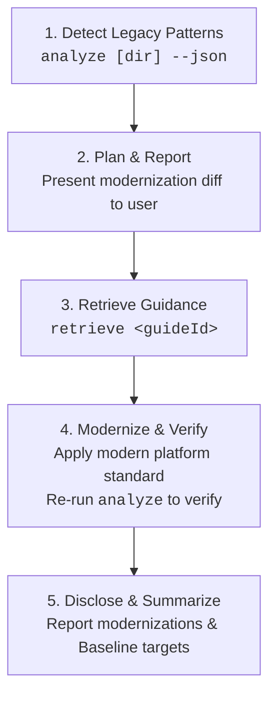
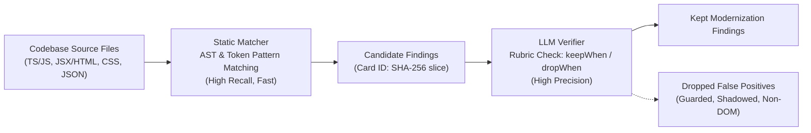

# Modern Web Guidance Analyzer (`src/analyzing`)

The Modern Web Guidance Analyzer scans brownfield web codebases for legacy idioms, obsolete polyfills, and userland workarounds, mapping every finding directly to a corresponding [Modern Web Guidance](../../guides) standard. It is designed for dual operation: fast, human-readable terminal reports for developers and structured machine-readable JSON for autonomous coding agents.

See [LEXICON.md](./LEXICON.md) for the canonical vocabulary (`Modernize`, `analyze`, `Guide Triage`, `Static Matcher`, `LLM Verifier`, `Detection Eval Judge`, `Update Eval`, and the `rule-writing` and `held-out` splits).

---

## 1. Quickstart

### Command-Line Interface

The analyzer can be run locally via the repository runner `gd` or in downstream projects via `npx`:

```bash
# In the modern-web-guidance repository:
node bin/gd.ts analyze [path/to/project] [options]

# In any brownfield project via npx:
npx -y modern-web-guidance@latest analyze [path/to/project] [options]
```

### CLI Options

| Flag | Type | Description |
| :--- | :--- | :--- |
| `[dir]` | Positional | Directory to analyze (defaults to current working directory). |
| `--json` | Flag | Output machine-readable JSON format for AI coding agents. |
| `--guide <guideId>` | String | Restrict analysis to a single guide ID (e.g. `--guide autofill-sign-in-form`). |
| `--experimental`, `--all-rules` | Flag | Run all active feature guides across `ALL_RULES`, including experimental rules. |
| `--include-docs-and-tests` | Flag | Include documentation, example, demo, and test files (skipped by default). |
| `-h, --help` | Flag | Display CLI usage information and exit. |

### Human-Readable Output Example

```text
Modern Web Guidance Analyzer — /workspace/etherpad-lite
Found 2 modernization opportunities across 2 guides:
Note: Static analysis results are provisional — verify against the Keep/Drop criteria below.
Skipped 53 docs and test files (pass --include-docs-and-tests to scan).

* form-fields-automatically-fit-contents [qualified] (1 finding)
  Imperative JavaScript auto-resizing of textareas and inputs using scrollHeight or autosize() should be replaced with CSS field-sizing: content.
  Keep when: A keyup, input, change, or keydown event listener dynamically recalculates a textarea or text input height/wi…
  Drop when: The code is guarded by a feature query checking CSS.supports("field-sizing", "content") or field-sizing suppo…
  - src/static/js/admin/settings.js:30
    $('.settings').autosize();

* responsive-table [qualified] (1 finding)
  Table cell stacking using td::before content: attr(data-*) without @container queries should be modernized with CSS Container Queries.
  Keep when: A CSS rule uses td::before or td:before with content: attr(data-label), attr(data-th), or attr(data-title) to…
  Drop when: The stylesheet already uses @container queries to adapt the table layout based on container width.; The conte…
  - src/static/css/admin.css:269
    td:before {

Retrieve a guide: npx modern-web-guidance retrieve <guide-id> (or pass --json for coding agents)
```

### Structured JSON Output (`--json`, abridged)

Coding agents receive structured JSON containing exact file coordinates, confidence tiers, message descriptions, verification rubrics, and copy-paste retrieval commands:

```json
{
  "targetDir": "/workspace/etherpad-lite",
  "totalFindings": 2,
  "guides": [
    {
      "guideId": "form-fields-automatically-fit-contents",
      "tier": "qualified",
      "summary": "Imperative JavaScript auto-resizing of textareas and inputs using scrollHeight or autosize() should be replaced with CSS field-sizing: content.",
      "retrieveCommand": "npx modern-web-guidance retrieve form-fields-automatically-fit-contents",
      "verifierRubric": {
        "keepWhen": [
          "A keyup, input, change, or keydown event listener dynamically recalculates a textarea or text input height/width using scrollHeight or scrollWidth to auto-expand the field as the user types.",
          "…"
        ],
        "dropWhen": [
          "The code is guarded by a feature query checking CSS.supports(\"field-sizing\", \"content\") or field-sizing support.",
          "…"
        ]
      },
      "count": 1,
      "findings": [
        {
          "ruleId": "form-fields-automatically-fit-contents",
          "file": "src/static/js/admin/settings.js",
          "line": 30,
          "message": "Library autosize() call auto-expands textarea/input fields; modernize with CSS field-sizing: content.",
          "codeSnippet": "   28 |       $('.settings').append(settings.results);\n   29 |       $('.settings').focus();\n>  30 |       $('.settings').autosize();\n   31 |     }\n   32 |     else{…",
          "summary": "Imperative JavaScript auto-resizing of textareas and inputs using scrollHeight or autosize() should be replaced with CSS field-sizing: content.",
          "verifierRubric": {
            "keepWhen": [
              "A keyup, input, change, or keydown event listener dynamically recalculates a textarea or text input height/width using scrollHeight or scrollWidth to auto-expand the field as the user types.",
              "…"
            ],
            "dropWhen": [
              "The code is guarded by a feature query checking CSS.supports(\"field-sizing\", \"content\") or field-sizing support.",
              "…"
            ]
          }
        }
      ]
    },
    {
      "guideId": "responsive-table",
      "tier": "qualified",
      "summary": "Table cell stacking using td::before content: attr(data-*) without @container queries should be modernized with CSS Container Queries.",
      "retrieveCommand": "npx modern-web-guidance retrieve responsive-table",
      "verifierRubric": {
        "keepWhen": [
          "A CSS rule uses td::before or td:before with content: attr(data-label), attr(data-th), or attr(data-title) to generate mobile stacked table card headers without container queries.",
          "…"
        ],
        "dropWhen": [
          "The stylesheet already uses @container queries to adapt the table layout based on container width.",
          "…"
        ]
      },
      "count": 1,
      "findings": [
        {
          "ruleId": "responsive-table/css-data-label-table",
          "file": "src/static/css/admin.css",
          "line": 269,
          "message": "CSS rule injects table cell headers via td::before content: attr(data-*); modernize with CSS Container Queries and accessible pseudo-element headers.",
          "codeSnippet": "   267 |   }\n   268 | \n>  269 |   td:before {\n   270 |     position: absolute;\n   271 |     top: 6px;…",
          "summary": "Table cell stacking using td::before content: attr(data-*) without @container queries should be modernized with CSS Container Queries.",
          "verifierRubric": {
            "keepWhen": [
              "A CSS rule uses td::before or td:before with content: attr(data-label), attr(data-th), or attr(data-title) to generate mobile stacked table card headers without container queries.",
              "…"
            ],
            "dropWhen": [
              "The stylesheet already uses @container queries to adapt the table layout based on container width.",
              "…"
            ]
          }
        }
      ]
    }
  ],
  "activeRuleCount": 8,
  "activeGuideCount": 6,
  "suspendedGuides": [
    "autofill-highlight-inputs",
    "complex-shapes",
    "interactions-in-complex-layouts",
    "language-detection"
  ],
  "skippedDocsAndTestsCount": 53
}
```

---

## 2. Modernize Workflow

For autonomous AI coding agents (such as Claude Code or Codex), modernizing existing code follows the **Modernize** workflow. The `analyze` subcommand serves as the detection step—finding legacy patterns and stopping there—while the agent carries out the planning, guidance retrieval, modern standard application, and verification:



1. **Detect Legacy Patterns (`analyze`)**: Execute `npx modern-web-guidance analyze <dir> --json` to detect candidate modernization targets across the project. `analyze` finds legacy patterns and stops there.
2. **Plan & Confirm**: Group detected findings by `guideId`, inspect source contexts against the verification rubric (`keepWhen`/`dropWhen`), and report a clear modernization proposal to the developer before editing code.
3. **Retrieve Guidance**: For each approved guide ID, run `npx modern-web-guidance retrieve "<guideId>"` to fetch the complete canonical guidance, including edge cases, accessibility invariants, and fallback strategies.
4. **Modernize & Verify**: Update legacy code to standard web platform features (e.g. native `<dialog>`, `content-visibility`, `autocomplete`). Re-run `analyze <dir> --json` to verify that findings are eliminated without regressions.
5. **Disclose & Summarize**: End the turn with a concise summary describing the modernized APIs and any browser Baseline implications.

---

## 3. Architecture: Static Matcher + LLM Verifier

High-precision static analysis requires balancing high recall against low matcher misfire rates across diverse real-world frameworks. The analyzer achieves this through a two-step runtime architecture:



### Static Matcher (High-Recall Deterministic Scanner)

- **Speed & Breadth**: Scans thousands of files in milliseconds using token pre-filters (`fastTokens`) before parsing ASTs.
- **Multi-Modal Matchers**: Evaluates JavaScript/TypeScript syntax trees via `ts-morph`, DOM elements and JSX props via custom AST visitors, CSS stylesheets via declaration parsing, and package dependencies via `package.json`.
- **Finding Identity**: Every finding receives a deterministic 12-character hex ID:
  $$\text{CardID} = \text{SHA256}(\text{repo} : \text{commit} : \text{guideId} : \text{file} : \text{line})[0..12]$$
  This provides stable tracking across repeat runs and evaluation datasets.

### LLM Verifier (Contextual Rubric Filter)

Candidate matches are validated against rule-specific rubrics defined in [`schema.ts`](./schema.ts):
- **`keepWhen` Criteria**: Verified when the candidate matches genuine legacy workarounds (e.g., custom event loops, manual clipboard workarounds, DIY popover positioning).
- **`dropWhen` Criteria**: Immediately discards false positives, including:
  - Code already guarded by feature detection (`'showPicker' in HTMLInputElement.prototype`).
  - Identifiers shadowed in unrelated scopes (e.g., local variables named `dialog` in audio or physics engines).
  - Out-of-domain contexts (WebGL canvas contexts, Node.js CLI tools).

---

## 4. Rule Authoring (`AnalyzerRule`)

Each analyzer rule implements the `AnalyzerRule` interface from [`schema.ts`](./schema.ts):

```typescript
export interface AnalyzerRule {
  readonly id: string;
  readonly guideId: string;
  readonly guideHash: string;
  readonly summary: string;
  readonly matcher: RuleMatcher;
  readonly verifierRubric: VerifierRubric;
}
```

### Supported Matcher Kinds

1. **`JsRuleMatcher` (`kind: 'js'`):** Analyzes JavaScript and TypeScript files using `ts-morph` AST navigation.
2. **`DomRuleMatcher` (`kind: 'dom'`):** Inspects HTML templates and JSX/TSX elements for tag names, attribute combinations, and missing modern platform attributes.
3. **`CssRuleMatcher` (`kind: 'css'`):** Checks CSS rules and style declarations for obsolete workarounds (e.g. manual `-webkit-line-clamp` fallbacks).
4. **`DependencyRuleMatcher` (`kind: 'dependency'`):** Flags obsolete third-party npm packages whose functionality has been superseded by native web platform APIs.

### Example Rule Implementation

```typescript
import type { AnalyzerRule, DomRuleMatcher } from '../schema.ts';

const matcher: DomRuleMatcher = {
  kind: 'dom',
  selector: 'input',
  fastTokens: ['type="password"', "type='password'"],
  matchElement(element) {
    const type = element.getAttribute('type');
    if (type !== 'password') return null;

    const hasAutocomplete = element.hasAttribute('autocomplete');
    if (hasAutocomplete) return null;

    return {
      message: 'Password input lacks standard autocomplete attribute; modern password managers require autocomplete="current-password" or autocomplete="new-password".',
    };
  },
};

export const autofillSignInFormRule: AnalyzerRule = {
  id: 'autofill-sign-in-form',
  guideId: 'autofill-sign-in-form',
  guideHash: 'a1b2c3d4e5f6',
  summary: 'Add standard autocomplete attributes to sign-in and registration form inputs.',
  matcher,
  verifierRubric: {
    keepWhen: [
      'Input element has type="password" without an autocomplete attribute.',
      'Input element accepts credential data inside an authentication or registration form.',
    ],
    dropWhen: [
      'Element already defines autocomplete="current-password" or autocomplete="new-password".',
      'Element is an internal mock, unit test fixture, or non-credential token input.',
    ],
  },
};
```

### Qualified Rules & Gated Execution

To keep terminal false alarms low when run in developer environments, the analyzer enforces qualification gating:
- **`QUALIFIED_RULES` (`QUALIFIED_GUIDE_IDS`):** By default in standard terminal CLI mode and `--json` mode, the analyzer runs rules for guides that meet the qualification standard: static matcher precision ≥ 90% at n ≥ 20 on held-out repositories, as scored by an LLM judge (not human-graded). In `--json` mode, complete `verifierRubric` definitions (`keepWhen` and `dropWhen`) are emitted so coding agents can perform runtime verification before proposing edits.
- **`ALL_RULES` (`--experimental` / `--all-rules`):** Executes all active feature guides across all rules in `ALL_RULES`, including experimental rules.

### Qualification Criteria

Rules qualify for default terminal shipping under the **Static Matcher precision standard**:
- **Static Matcher Precision $\ge 90.0\%$ at $n \ge 20$:** Evaluated on held-out out-of-sample repositories (`precision` before LLM Verifier), as scored by an LLM judge (not human-graded).
- Rules requiring runtime LLM Verifier evaluation (`needs-verifier`) or with static matcher precision below 90% remain in the experimental tier until their static matchers reach the standard.

### 2-Axis Triage Taxonomy

Every web platform standard in the catalog is classified across two orthogonal axes:
- **Axis 1: Detection (`detection`):**
  - `direct-token` & `structural-ast`: Deterministic token, AST, DOM, CSS, or `package.json` patterns with high signal-to-noise ratio requiring no LLM runtime verification.
  - `needs-verifier`: Pattern detectable by static matchers but requiring runtime LLM Verifier evaluation against a `verifierRubric` (`keepWhen` / `dropWhen`) to reject subtle false alarms.
  - `no-legacy-pattern`: Visual, behavioral, or greenfield capability without a distinguishable brownfield syntax footprint to replace.
- **Axis 2: Update Scope (`updateScope`):**
  - `local-swap`: Replacing or adding a property, selector, attribute, or call at the same site (e.g., standard `autocomplete` attributes, `text-wrap: balance`, `field-sizing: content`).
  - `cross-layer-refactor`: Deleting imperative JS listeners, observers, or helper libraries and moving behavior into declarative CSS or HTML (`@starting-style`, `animation-timeline`, `:has()`).
  - `widget-recipe`: Coordinating HTML structure, CSS layout/styling, and JS behavior across multiple parts of a composite UI widget.
  - `n/a`: Applicable when detection is `no-legacy-pattern`.

### Qualified Feature Guides

*Scores are LLM judge estimates on held-out repositories (not human-graded).*

| # | Guide ID | Matcher Kind | Static Matcher Precision | Post-Verifier Precision | Sample Size ($n$) | Modern Platform Target |
| :- | :--- | :--- | :--- | :--- | :--- | :--- |
| 1 | `responsive-table` | Dependency & CSS | 100.0% (35/35) | 100.0% (35/35) | 35 | CSS Container Queries (`@container`) and sticky headers |
| 2 | `scroll-entry-exit-effects` | Dependency & JS | 97.1% (34/35) | 97.1% (34/35) | 35 | CSS Scroll-Driven Animations (`animation-timeline: view()`) |
| 3 | `form-fields-automatically-fit-contents` | CSS | 96.3% (26/27) | 100.0% (26/26) | 27 | CSS `field-sizing: content` |
| 4 | `scrollspy` | CSS | 94.3% (33/35) | 94.3% (33/35) | 35 | CSS `scroll-target-group: auto` and `:target-current` |
| 5 | `autofill-address-form` | DOM | 91.7% (22/24) | 100.0% (20/20) | 24 | Standard `autocomplete` attributes on address form inputs |
| 6 | `autofill-sign-in-form` | DOM | 91.4% (32/35) | 100.0% (31/31) | 35 | Standard `autocomplete="username"` and `autocomplete="current-password"` |

---

## 5. Evaluation, Update Eval & Measurement Framework

The analyzer gates rules on evaluation against held-out repositories before any rule is published in `QUALIFIED_RULES`.

### Evaluation Subsystem (`src/analyzing/eval/`)

- **`guide-triage.ts`**: Implements the 2-axis triage taxonomy (`Detection` and `Update Scope`) and maintains canonical metadata for all web platform guides.
- **`detection-eval.ts`**: Runs multi-pass LLM judge evaluation (`gemini-3.8-flash`) against human-graded cards (`grades.jsonl`) to measure true-positive and matcher misfire rates with majority voting.
- **`llm-verifier.ts`**: Implements the runtime and eval-time LLM verifier evaluating candidate matches against `verifierRubric` (`keepWhen` / `dropWhen`) specifications.
- **`update-eval.ts`**: Automated patch validation harness testing candidate modernization updates across 3 classes of bad patches (`no-op`, `deletion-gutting`, `broken/evasion`) and reference good fixes.
- **`stats.ts`**: Statistical foundations implementing Wilson binomial confidence intervals, sequential stopping decisions, and TPR/TNR metrics.
- **`prompts.ts`**: Centralized prompt templates, thinking budgets, and content-hashed version tracking across all LLM evaluation passes.

### 2-Split Corpus Architecture (`rule-writing` vs `held-out`)

The evaluation corpus is divided into two isolated splits across 26,426 files and 8,508 repositories covering active feature guides:
- **`rule-writing`:** Used by engineers and agents to discover legacy patterns, author Static Matcher AST patterns, and tune LLM Verifier rubrics.
- **`held-out`:** Reserved strictly for out-of-sample precision and recall validation. Kept separate when authoring or debugging rules to evaluate generalization on unseen code.

Cross-split boundary isolation is statically verified by internal audit tooling.

### Update Eval

To evaluate end-to-end code modernization without falling into the "Deletion Equals Resolution" trap , **Update Eval** (`update-eval.ts`) enforces three static checks on every candidate modernization update:
- **Check 1 (Finding Eliminated Check):** Splices the patched window into the full file and verifies `0` remaining findings in the window and reduced full-file finding count.
- **Check 2 (Modern Syntax & Anti-Gutting Check):** Verifies clean AST/DOM/CSS parsing (`ts-morph` with JSX support, `linkedom`, `cssomnom`), top-level export retention, and comment-stripped presence of the guide's positive modern web feature.
- **Check 3 (Behavioral Check):** Runs behavioral/test assertions when available.
- **Verified Benchmarks:** Verified on the 3-class seeded bad-patch sensitivity suite (`no-op`, `deletion-gutting`, `broken/evasion`) and reference good fixes.

### Running Evaluation Benchmarks

```bash
# Run unit tests across analyzing subsystem:
node --test "src/analyzing/**/*.test.ts"

# Run preflight verification (build, typecheck, lint):
pnpm run preflight

# Run Detection Eval Judge benchmark on evaluation decks:
node --env-file=.env src/analyzing/eval/detection-eval.ts

# Run seeded sensitivity suite & end-to-end agentic update evaluation:
node --env-file=.env src/analyzing/eval/update-eval.ts
```

---

## 6. Contributor Playbook: How to Add & Qualify an Analyzer Rule

Follow this 4-step workflow to author, test, and qualify a rule for modern web guidance:

### Step 1: Guide Triage
1. **Verify Guide Triage status**: Ensure the feature guide is triaged with `detection: 'direct-token'`, `'structural-ast'`, or `'needs-verifier'` (never `'no-legacy-pattern'`).
2. **Record the Guide Triage entry**: Identify concrete 1-to-1 legacy APIs, CSS workarounds, or npm packages that the modern platform feature directly replaces (`replaces`), alongside lookalike patterns that are out of scope (`doesNotReplace`).
3. **Ground in real code**: Inspect only the `rule-writing` corpus. Do not inspect held-out code.

### Step 2: Static Matcher Authoring
1. **Choose matcher kind**: `JsRuleMatcher` (AST via `ts-morph`), `DomRuleMatcher` (HTML/JSX DOM via `linkedom`), `CssRuleMatcher` (CSS via `cssomnom`), or `DependencyRuleMatcher` (`package.json`).
2. **Implement in `src/analyzing/rules/<guide-id>.ts`**:
   - Set `fastTokens` pre-filters to ensure fast string pre-screening.
   - Target high recall on the structural shape of the legacy idiom.
   - Return clean finding messages explaining the modern replacement.
3. **Add unit test suite in `src/analyzing/rules/<guide-id>.test.ts`**: Test positive examples, negative examples, and edge cases.

### Step 3: LLM Verifier Rubric
1. **Define `verifierRubric` in the rule definition**:
   - `keepWhen`: Precise criteria matching genuine legacy workarounds.
   - `dropWhen`: Immediate exclusions (feature detection guards, shadowed variables, out-of-domain contexts).
2. **Agentic verification**: Ensure that `--json` output emits the complete rubric so AI coding agents can verify findings before proposing modernizations.

### Step 4: Held-Out Qualification
1. **Run preflight checks**: `pnpm run preflight` and `node --test "src/analyzing/**/*.test.ts"`.
2. **Run detection and update evaluation**: `node --env-file=.env src/analyzing/eval/update-eval.ts` and `node --env-file=.env src/analyzing/eval/detection-eval.ts`.
3. **Qualification criteria**:
   - **Experimental Rule**: Active in `ALL_RULES`, available under `--experimental` / `--all-rules`.
   - **Qualified Rule**: Promoted to `QUALIFIED_GUIDE_IDS` for default terminal shipping once it meets the Static Matcher Precision qualification standard (>= 90% at n >= 20) on the untuned `held-out` split.
