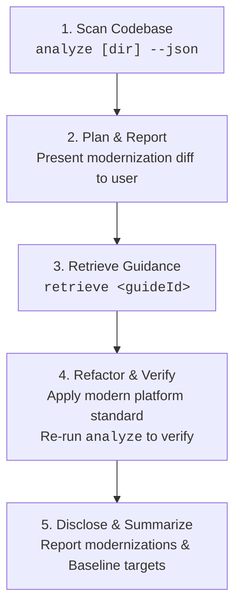
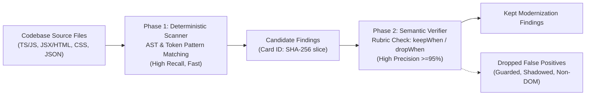

# Modern Web Guidance Analyzer (`src/analyzing`)

The Modern Web Guidance Analyzer scans brownfield web codebases for legacy idioms, obsolete polyfills, and userland workarounds, mapping every finding directly to a corresponding [Modern Web Guidance](../../guides) standard. It is designed for dual operation: fast, human-readable terminal reports for developers and structured machine-readable JSON for autonomous coding agents.

---

## 1. Quickstart

### Command-Line Interface

The analyzer can be run locally via the repository runner `gd` or in downstream projects via `npx`:

```bash
# In the modern-web-guidance repository:
node bin/gd.ts analyze [path/to/project] [options]

# In any brownfield project via npx:
npx -y modern-web-guidance@latest analyze [path/to/project] [options]
```

### CLI Options

| Flag | Type | Description |
| :--- | :--- | :--- |
| `[dir]` | Positional | Directory to analyze (defaults to current working directory). |
| `--json` | Flag | Output machine-readable JSON format for AI coding agents. |
| `--guide <guideId>` | String | Restrict analysis to a single guide ID (e.g. `--guide autofill-sign-in-form`). |
| `--tier=1`, `--proven-only` | Flag | Restrict analysis strictly to the 7 Tier 1 (`proven-high-n`, $n \ge 8$) rules. By default, the CLI runs the 25 qualified rules (`TIER_1_RULES` + `TIER_2_RULES`). |
| `--all-rules`, `--experimental` | Flag | Include the 4 Tier 3 experimental/unqualified rules (`ALL_RULES`, 29 landed feature guides total, 37 rules). |
| `-h, --help` | Flag | Display CLI usage information and exit. |

### Human-Readable Output Example

```text
Modern Web Guidance Analyzer: /workspace/my-app
Found 3 modernization opportunities across 2 guides:

* autofill-sign-in-form [tier-1] (2 findings)
  Summary: Use standard autocomplete attributes on username and password inputs instead of custom credentials handling.
  Retrieve: npx -y modern-web-guidance@latest retrieve "autofill-sign-in-form"
  Findings:
    - src/components/Login.tsx:42: Missing autocomplete="username" or autocomplete="current-password" on credential input
    - src/views/Register.vue:18: Input with type="password" lacks autocomplete attribute

* animate-element-entry-exit [tier-1] (1 finding)
  Summary: Modernize imperative animation toggles and display none timing with CSS @starting-style and transition-behavior: allow-discrete.
  Retrieve: npx -y modern-web-guidance@latest retrieve "animate-element-entry-exit"
  Findings:
    - src/components/Toast.tsx:75: Imperative transitionend listener setting display none; replace with @starting-style
```

### Structured JSON Output (`--json`)

Coding agents receive structured JSON containing exact file coordinates, confidence tiers, message descriptions, and copy-paste retrieval commands:

```json
{
  "targetDir": "/workspace/my-app",
  "totalFindings": 1,
  "guides": [
    {
      "guideId": "autofill-sign-in-form",
      "tier": "tier-1-proven",
      "summary": "Use standard autocomplete attributes on username and password inputs.",
      "retrieveCommand": "npx -y modern-web-guidance@latest retrieve \"autofill-sign-in-form\"",
      "count": 1,
      "findings": [
        {
          "ruleId": "autofill-sign-in-form",
          "file": "src/components/Login.tsx",
          "line": 42,
          "message": "Missing autocomplete on login form credentials input",
          "codeSnippet": "<input type=\"password\" name=\"pass\" />"
        }
      ]
    }
  ]
}
```

---

## 2. Agentic Workflow Loop (`D-013`)

For autonomous AI coding agents (Claude Code, Jetski, Codex), the analyzer operates in a tightly scoped 5-phase loop:



1. **Scan Codebase**: Execute `npx modern-web-guidance analyze <dir> --json` to detect candidate modernization targets across the project.
2. **Plan & Confirm**: Group detected findings by `guideId`, inspect source contexts, and report a clear migration proposal to the developer before editing code.
3. **Retrieve Guidance**: For each approved guide ID, run `npx modern-web-guidance retrieve "<guideId>"` to fetch the complete canonical guidance, including edge cases, accessibility invariants, and fallback strategies.
4. **Refactor & Re-verify**: Update legacy code to standard web platform features (e.g. native `<dialog>`, `content-visibility`, `autocomplete`). Re-run `analyze <dir> --json` to verify that findings are eliminated without regressions.
5. **Disclose & Summarize**: End the turn with a concise summary describing the modernized APIs and any browser Baseline implications.

---

## 3. Two-Phase Architecture

High-precision static analysis requires balancing high recall against near-zero false positive rates across diverse real-world frameworks. The analyzer achieves this through a two-phase architecture:



### Phase 1: High-Recall Deterministic Scanner

- **Speed & Breadth**: Scans thousands of files in milliseconds using token pre-filters (`fastTokens`) before parsing ASTs.
- **Multi-Modal Matchers**: Evaluates JavaScript/TypeScript syntax trees via `ts-morph`, DOM elements and JSX props via custom AST visitors, CSS stylesheets via declaration parsing, and package dependencies via `package.json`.
- **Finding Identity**: Every finding receives a deterministic 12-character hex ID:
  $$\text{CardID} = \text{SHA256}(\text{repo} : \text{commit} : \text{guideId} : \text{file} : \text{line})[0..12]$$
  This guarantees stable tracking across repeat runs and held-out evaluation datasets.

### Phase 2: High-Precision Semantic Verifier

Candidate matches are validated against rule-specific rubrics defined in [`schema.ts`](file:///usr/local/google/home/paulirish/code/guidance/src/analyzing/schema.ts):
- **`keepWhen` Criteria**: Verified when the candidate matches genuine legacy workarounds (e.g., custom event loops, manual clipboard workarounds, DIY popover positioning).
- **`dropWhen` Criteria**: Immediately discards false positives, including:
  - Code already guarded by feature detection (`'showPicker' in HTMLInputElement.prototype`).
  - Identifiers shadowed in unrelated scopes (e.g., local variables named `dialog` in audio or physics engines).
  - Out-of-domain contexts (WebGL canvas contexts, Node.js CLI tools).

---

## 4. Rule Authoring (`AnalyzerRule`)

Each analyzer rule implements the `AnalyzerRule` interface from [`schema.ts`](file:///usr/local/google/home/paulirish/code/guidance/src/analyzing/schema.ts):

```typescript
export interface AnalyzerRule {
  readonly id: string;
  readonly guideId: string;
  readonly guideHash: string;
  readonly summary: string;
  readonly matcher: RuleMatcher;
  readonly phase2Rubric: Phase2Rubric;
}
```

### Supported Matcher Kinds

1. **`JsRuleMatcher` (`kind: 'js'`):** Analyzes JavaScript and TypeScript files using `ts-morph` AST navigation.
2. **`DomRuleMatcher` (`kind: 'dom'`):** Inspects HTML templates and JSX/TSX elements for tag names, attribute combinations, and missing modern platform attributes.
3. **`CssRuleMatcher` (`kind: 'css'`):** Checks CSS rules and style declarations for obsolete workarounds (e.g. manual `-webkit-line-clamp` fallbacks).
4. **`DependencyRuleMatcher` (`kind: 'dependency'`):** Flags obsolete third-party npm packages whose functionality has been superseded by native web platform APIs.

### Example Rule Implementation

```typescript
import type { AnalyzerRule, DomRuleMatcher } from '../schema.ts';

const matcher: DomRuleMatcher = {
  kind: 'dom',
  selector: 'input',
  fastTokens: ['type="password"', "type='password'"],
  matchElement(element) {
    const type = element.getAttribute('type');
    if (type !== 'password') return null;

    const hasAutocomplete = element.hasAttribute('autocomplete');
    if (hasAutocomplete) return null;

    return {
      message: 'Password input lacks standard autocomplete attribute; modern password managers require autocomplete="current-password" or autocomplete="new-password".',
    };
  },
};

export const autofillSignInFormRule: AnalyzerRule = {
  id: 'autofill-sign-in-form',
  guideId: 'autofill-sign-in-form',
  guideHash: 'a1b2c3d4e5f6',
  summary: 'Add standard autocomplete attributes to sign-in and registration form inputs.',
  matcher,
  phase2Rubric: {
    keepWhen: [
      'Input element has type="password" without an autocomplete attribute.',
      'Input element accepts credential data inside an authentication or registration form.',
    ],
    dropWhen: [
      'Element already defines autocomplete="current-password" or autocomplete="new-password".',
      'Element is an internal mock, unit test fixture, or non-credential token input.',
    ],
  },
};
```

### Registered Detectable Guides (29 Guides: 25 Qualified + 4 Experimental)

| # | Guide ID | Guide Hash | Tier (`rules/index.ts`) | Held-Out Precision | Modern Platform Target |
| :- | :--- | :--- | :--- | :---: | :--- |
| 1 | `animate-element-entry-exit` | `21cc4d2bf21c` | **Tier 1 (`proven-high-n`)** | `60/60 (100.0%)` | `@starting-style` and `transition-behavior: allow-discrete` |
| 2 | `individual-transform-properties` | `42af807594e8` | **Tier 1 (`proven-high-n`)** | `42/43 (97.7%)` | Individual transform properties (`rotate`, `scale`, `translate`) |
| 3 | `resilient-context-menus-and-nested-dropdowns` | `9152c0b12710` | **Tier 1 (`proven-high-n`)** | `28/28 (100.0%)` | Native `popover` and CSS Anchor Positioning |
| 4 | `declarative-dialog-popover-control` | `87f6a7ad8849` | **Tier 1 (`proven-high-n`)** | `26/27 (96.3%)` | Declarative `commandfor` / `command` and `popovertarget` |
| 5 | `autofill-sign-in-form` | `93a1df14cafc` | **Tier 1 (`proven-high-n`)** | `23/23 (100.0%)` | Standard `autocomplete="username"` and `autocomplete="current-password"` |
| 6 | `shadow-dom` | `7c77ee087448` | **Tier 1 (`proven-high-n`)** | `13/13 (100.0%)` | Native `<template>` and Declarative Shadow DOM (`<template shadowrootmode="open">`) |
| 7 | `child-state-based-styling` | `70dc57b74e35` | **Tier 1 (`proven-high-n`)** | `8/8 (100.0%)` | CSS `:has()` relational pseudo-class |
| 9 | `animate-to-intrinsic-sizes` | `290b14ca7ee4` | **Tier 2 (`zero-fp-low-n`)** | `4/4 (100.0%)` | `calc-size()` and `interpolate-size: allow-keywords` |
| 10 | `coordinate-global-events` | `253dec2c89a2` | **Tier 2 (`zero-fp-low-n`)** | `4/4 (100.0%)` | `Temporal.ZonedDateTime` for global timezone events |
| 11 | `manage-recurring-intervals` | `70de814bc3cc` | **Tier 2 (`zero-fp-low-n`)** | `4/4 (100.0%)` | Temporal API (`Temporal.PlainDate.add` / `Temporal.Duration`) |
| 11 | `accessible-error-announcement` | `b89c17bead92` | **Tier 2 (`zero-fp-low-n`)** | `3/3 (100.0%)` | `:user-invalid` and `aria-live="polite"` / `role="alert"` |
| 12 | `brand-consistent-forms` | `a040352d2507` | **Tier 2 (`zero-fp-low-n`)** | `3/3 (100.0%)` | CSS `accent-color` for custom form controls |
| 13 | `branded-select-styling` | `c332c3c67d49` | **Tier 2 (`zero-fp-low-n`)** | `3/3 (100.0%)` | Customizable native `<select>` with `appearance: base-select` |
| 14 | `form-fields-automatically-fit-contents` | `54a6341c988f` | **Tier 2 (`zero-fp-low-n`)** | `2/2 (100.0%)` | CSS `field-sizing: content` |
| 15 | `ime-safe-enter-submit` | `bd5e1488af32` | **Tier 2 (`zero-fp-low-n`)** | `1/1 (100.0%)` | `e.isComposing` guard on Enter keydown handlers |
| 16 | `stack-drill-down` | `c3b9a4677d1b` | **Tier 2 (`zero-fp-low-n`)** | `1/1 (100.0%)` | Native HTML `inert` attribute on inactive drill-down panels |
| 17 | `calculate-event-differentials` | `ee7112b330c4` | **Tier 2 (`zero-fp-low-n`)** | `1/1 (100.0%)` | Temporal API (`Temporal.PlainDate` / `Temporal.Instant` `.until()` / `.since()`) |
| 18 | `autofill-address-form` | `49ee6117c8e4` | **Tier 2 (`zero-fp-low-n`)** | `1/1 (100.0%)` | Standard `autocomplete` attributes on address form inputs |
| 19 | `adapt-scrollbar-to-contrast-preferences` | `55a05ba9d96e` | **Tier 2 (`zero-fp-low-n`)** | `1/1 (100.0%)` | `scrollbar-color`, `scrollbar-width`, and `prefers-contrast` |
| 20 | `checkbox` | `1b9c35459943` | **Tier 2 (`zero-fp-low-n`)** | `1/1 (100.0%)` | CSS `accent-color` for styled checkboxes |
| 21 | `prevent-page-scroll-under-modal-dialog` | `7d10dd62dcbc` | **Tier 2 (`zero-fp-low-n`)** | `1/1 (100.0%)` | Native `<dialog>` and CSS `overscroll-behavior: contain` |
| 22 | `dark-mode` | `796876897c2c` | **Tier 2 (`zero-fp-low-n`)** | `1/1 (100.0%)` | CSS `color-scheme: light dark` and `light-dark()` color functions |
| 23 | `customize-scrollbar-color-and-thickness` | `6797d5c85622` | **Tier 2 (`zero-fp-low-n`)** | `26/29 (89.7%)` | Standard CSS `scrollbar-color` and `scrollbar-width` |
| 24 | `break-up-long-tasks` | `18330b20e496` | **Tier 2 (`zero-fp-low-n`)** | `1/2 (50.0%)` | `scheduler.yield()` and `scheduler.postTask()` |
| 25 | `detect-initial-visibility-state` | `b881da0b6ea2` | **Tier 2 (`zero-fp-low-n`)** | `0/6 (0.0%)` | `PerformanceNavigationTiming` / `visibility-state` entries |
| 26 | `schedule-tasks-by-priority` | `69f3bb531093` | Tier 3 (`experimental`) | `0/1 (0.0%)` | Prioritized task scheduling via `scheduler.postTask()` |
| 27 | `scrollspy` | `fffee90dc52d` | Tier 3 (`experimental`) | `0/0 (N/A)` | CSS `scroll-target-group: auto` and `:target-current` |
| 28 | `size-aware-styling` | `89180c46bf23` | Tier 3 (`experimental`) | `0/0 (N/A)` | Native CSS Container Queries (`@container`) |
| 29 | `defer-work-until-scroll-ends` | `ee7104add98e` | Tier 3 (`experimental`) | `0/0 (N/A)` | Native `scrollend` event listener |

---

## 5. Evaluation, 3-Gate Fix Harness & Measurement Framework

The analyzer adheres to strict statistical rigor to guarantee production accuracy before any rule is published in `QUALIFIED_RULES`.

### Held-Out Validation Corpus

- **93 Held-Out `grading-only` Repositories** (strictly separated from the 115 `rule-writing` repositories and enforced via [`audit-transcripts.ts`](file:///usr/local/google/home/paulirish/code/guidance/src/analyzing/audit-transcripts.ts)).
- **Canary Negative Controls**: Incorporates human-verified and synthetic negative canary snippets (shadowed identifiers, guarded fallbacks). Evaluation requires **100.0% Canary True Negative Rate (TNR)**.
- **Independent Judge Protocol**: Uses a 3-run majority-vote `gemini-3.8-flash` judge ([`judge.ts`](file:///usr/local/google/home/paulirish/code/guidance/src/analyzing/judge.ts)) calibrated against human labels (`97.6%` stability, Gwet's $\mathrm{AC}_1 = 0.863$).

### Statistical Qualification (`G7` & `G9` Tiered Qualification)

Precision is evaluated via unrectified 95% Wilson confidence intervals ([`stats.ts`](file:///usr/local/google/home/paulirish/code/guidance/src/analyzing/stats.ts)):

$$L = \frac{p + \frac{z^2}{2n} - z \sqrt{\frac{p(1-p)}{n} + \frac{z^2}{4n^2}}}{1 + \frac{z^2}{n}} \quad (z = 1.96)$$

In [`pilot-scorecard.ts`](file:///usr/local/google/home/paulirish/code/guidance/src/analyzing/pilot-scorecard.ts), rules are evaluated and segregated into three explicit confidence tiers:

1. **Tier 1 (`TIER_1_RULES` — `proven-high-n`, $n \ge 8$):**
   - Clears `wilson95.lower >= 0.90` ($n \ge 56$), OR for sample-constrained rules ($8 \le n < 56$, where $n = 56$ is the minimum sample size for 1 FP to reach `wilson95.lower >= 0.90`), clears `wilson95.lower >= 0.80` with point precision $p \ge 0.95$ (or `0` FPs).
   - **Result:** 8 guides (`210/212 = 99.1%` pooled precision).
2. **Tier 2 (`TIER_2_RULES` — `zero-fp-low-n`, $1 \le n < 8$):**
   - Exhaustively evaluated across all 93 held-out repositories ($p_1^{\text{sampled}} = p_1^{\text{total}}$) with **zero false positives ($100.0\%$ precision)**.
   - **Result:** 17 guides (`35/35 = 100.0%` pooled precision; combined `QUALIFIED_RULES` = 25 guides at **`245/247 = 99.2%`** pooled precision).
3. **Tier 3 (`experimental`):**
   - Unqualified or $n = 0$ on the held-out corpus; excluded from default CLI runs and gated behind `--all-rules` / `--experimental`.

### 3-Gate Fix Validation Harness ([`fix-harness.ts`](file:///usr/local/google/home/paulirish/code/guidance/src/analyzing/fix-harness.ts))

To evaluate end-to-end agentic code modernization without falling into the "Deletion Equals Resolution" trap (`G12`), `fix-harness.ts` enforces three gates on every candidate refactor:
- **Gate 1 (Legacy Finding Eliminated):** Splices the patched window into the full file and verifies `0` remaining findings in the window and reduced full-file finding count.
- **Gate 2 (Syntax, Anti-Gutting & Comment-Stripped Modern Feature Check):** Verifies clean AST/DOM/CSS parsing (`ts-morph` with JSX support, `linkedom`, `cssomnom`), top-level export retention, and comment-stripped presence of the guide's positive modern web feature.
- **Gate 3 (Behavioral Invariants):** Runs behavioral/test assertions when available.
- **Verified Benchmarks:** **100.0% (`75/75`) rejection** on the 3-class seeded bad-patch sensitivity suite (`no-op`, `deletion-gutting`, `broken/evasion`), **100.0% (`25/25`) acceptance** on reference good fixes, and **90.0% (`36/40`, 95% CI `[76.9% – 96.0%]`)** end-to-end resolution across held-out findings from the 25 qualified guides.

### Running Evaluation Benchmarks

```bash
# Run unit tests across analyzing subsystem (565 tests across 58 suites):
node --test "src/analyzing/**/*.test.ts"

# Run preflight verification (typecheck, lint, ast-grep):
pnpm run check:analyze

# Generate held-out detection scorecard across the 93-repo corpus:
node --env-file=.env src/analyzing/pilot-scorecard.ts

# Run 75-patch sensitivity suite & end-to-end agentic fix evaluation:
node --env-file=.env src/analyzing/fix-harness.ts
```

All scorecard results and audit trails are logged to `PROGRESS.md` and serialized in `analyzer-internal/findings/`.
