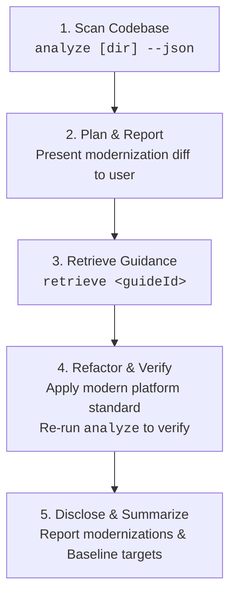
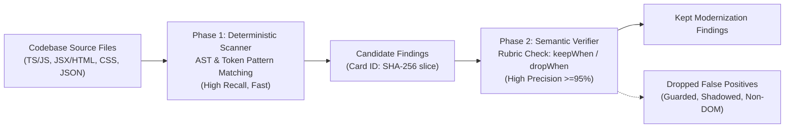

# Modern Web Guidance Analyzer (`src/analyzing`)

The Modern Web Guidance Analyzer scans brownfield web codebases for legacy idioms, obsolete polyfills, and userland workarounds, mapping every finding directly to a corresponding [Modern Web Guidance](../../guides) standard. It is designed for dual operation: fast, human-readable terminal reports for developers and structured machine-readable JSON for autonomous coding agents.

---

## 1. Quickstart

### Command-Line Interface

The analyzer can be run locally via the repository runner `gd` or in downstream projects via `npx`:

```bash
# In the modern-web-guidance repository:
node bin/gd.ts analyze [path/to/project] [options]

# In any brownfield project via npx:
npx -y modern-web-guidance@latest analyze [path/to/project] [options]
```

### CLI Options

| Flag | Type | Description |
| :--- | :--- | :--- |
| `[dir]` | Positional | Directory to analyze (defaults to current working directory). |
| `--json` | Flag | Output machine-readable JSON format for AI coding agents. |
| `--guide <guideId>` | String | Restrict analysis to a single guide ID (e.g. `--guide autofill-sign-in-form`). |
| `-h, --help` | Flag | Display CLI usage information and exit. |

### Human-Readable Output Example

```text
Modern Web Guidance Analyzer: /workspace/my-app
Found 3 modernization opportunities across 2 guides:

* autofill-sign-in-form (2 findings)
  Summary: Use standard autocomplete attributes on username and password inputs instead of custom credentials handling.
  Retrieve: npx -y modern-web-guidance@latest retrieve "autofill-sign-in-form"
  Findings:
    - src/components/Login.tsx:42: Missing autocomplete="username" or autocomplete="current-password" on credential input
    - src/views/Register.vue:18: Input with type="password" lacks autocomplete attribute

* dialog-element (1 finding)
  Summary: Replace custom modal div overlays and keydown trap handlers with native HTML <dialog>.
  Retrieve: npx -y modern-web-guidance@latest retrieve "dialog-element"
  Findings:
    - src/components/Modal.tsx:75: Custom backdrop and escape listener detected; replace with native <dialog>
```

### Structured JSON Output (`--json`)

Coding agents receive structured JSON containing exact file coordinates, message descriptions, and copy-paste retrieval commands:

```json
{
  "targetDir": "/workspace/my-app",
  "totalFindings": 1,
  "guides": [
    {
      "guideId": "autofill-sign-in-form",
      "summary": "Use standard autocomplete attributes on username and password inputs.",
      "retrieveCommand": "npx -y modern-web-guidance@latest retrieve \"autofill-sign-in-form\"",
      "count": 1,
      "findings": [
        {
          "ruleId": "autofill-sign-in-form",
          "file": "src/components/Login.tsx",
          "line": 42,
          "message": "Missing autocomplete on login form credentials input",
          "codeSnippet": "<input type=\"password\" name=\"pass\" />"
        }
      ]
    }
  ]
}
```

---

## 2. Agentic Workflow Loop (`D-013`)

For autonomous AI coding agents (Claude Code, Jetski, Codex), the analyzer operates in a tightly scoped 5-phase loop:



1. **Scan Codebase**: Execute `npx modern-web-guidance analyze <dir> --json` to detect candidate modernization targets across the project.
2. **Plan & Confirm**: Group detected findings by `guideId`, inspect source contexts, and report a clear migration proposal to the developer before editing code.
3. **Retrieve Guidance**: For each approved guide ID, run `npx modern-web-guidance retrieve "<guideId>"` to fetch the complete canonical guidance, including edge cases, accessibility invariants, and fallback strategies.
4. **Refactor & Re-verify**: Update legacy code to standard web platform features (e.g. native `<dialog>`, `content-visibility`, `autocomplete`). Re-run `analyze <dir> --json` to verify that findings are eliminated without regressions.
5. **Disclose & Summarize**: End the turn with a concise summary describing the modernized APIs and any browser Baseline implications.

---

## 3. Two-Phase Architecture

High-precision static analysis requires balancing high recall against near-zero false positive rates across diverse real-world frameworks. The analyzer achieves this through a two-phase architecture:



### Phase 1: High-Recall Deterministic Scanner

- **Speed & Breadth**: Scans thousands of files in milliseconds using token pre-filters (`fastTokens`) before parsing ASTs.
- **Multi-Modal Matchers**: Evaluates JavaScript/TypeScript syntax trees via `ts-morph`, DOM elements and JSX props via custom AST visitors, CSS stylesheets via declaration parsing, and package dependencies via `package.json`.
- **Finding Identity**: Every finding receives a deterministic 12-character hex ID:
  $$\text{CardID} = \text{SHA256}(\text{repo} : \text{commit} : \text{guideId} : \text{file} : \text{line})[0..12]$$
  This guarantees stable tracking across repeat runs and held-out evaluation datasets.

### Phase 2: High-Precision Semantic Verifier

Candidate matches are validated against rule-specific rubrics defined in [`schema.ts`](file:///usr/local/google/home/paulirish/code/guidance/src/analyzing/schema.ts):
- **`keepWhen` Criteria**: Verified when the candidate matches genuine legacy workarounds (e.g., custom event loops, manual clipboard workarounds, DIY popover positioning).
- **`dropWhen` Criteria**: Immediately discards false positives, including:
  - Code already guarded by feature detection (`'showPicker' in HTMLInputElement.prototype`).
  - Identifiers shadowed in unrelated scopes (e.g., local variables named `dialog` in audio or physics engines).
  - Out-of-domain contexts (WebGL canvas contexts, Node.js CLI tools).

---

## 4. Rule Authoring (`AnalyzerRule`)

Each analyzer rule implements the `AnalyzerRule` interface from [`schema.ts`](file:///usr/local/google/home/paulirish/code/guidance/src/analyzing/schema.ts):

```typescript
export interface AnalyzerRule {
  readonly id: string;
  readonly guideId: string;
  readonly guideHash: string;
  readonly summary: string;
  readonly matcher: RuleMatcher;
  readonly phase2Rubric: Phase2Rubric;
}
```

### Supported Matcher Kinds

1. **`JsRuleMatcher` (`kind: 'js'`):** Analyzes JavaScript and TypeScript files using `ts-morph` AST navigation.
2. **`DomRuleMatcher` (`kind: 'dom'`):** Inspects HTML templates and JSX/TSX elements for tag names, attribute combinations, and missing modern platform attributes.
3. **`CssRuleMatcher` (`kind: 'css'`):** Checks CSS rules and style declarations for obsolete workarounds (e.g. manual `-webkit-line-clamp` fallbacks).
4. **`DependencyRuleMatcher` (`kind: 'dependency'`):** Flags obsolete third-party npm packages whose functionality has been superseded by native web platform APIs.

### Example Rule Implementation

```typescript
import type { AnalyzerRule, DomRuleMatcher } from '../schema.ts';

const matcher: DomRuleMatcher = {
  kind: 'dom',
  selector: 'input',
  fastTokens: ['type="password"', "type='password'"],
  matchElement(element) {
    const type = element.getAttribute('type');
    if (type !== 'password') return null;

    const hasAutocomplete = element.hasAttribute('autocomplete');
    if (hasAutocomplete) return null;

    return {
      message: 'Password input lacks standard autocomplete attribute; modern password managers require autocomplete="current-password" or autocomplete="new-password".',
    };
  },
};

export const autofillSignInFormRule: AnalyzerRule = {
  id: 'autofill-sign-in-form',
  guideId: 'autofill-sign-in-form',
  guideHash: 'a1b2c3d4e5f6',
  summary: 'Add standard autocomplete attributes to sign-in and registration form inputs.',
  matcher,
  phase2Rubric: {
    keepWhen: [
      'Input element has type="password" without an autocomplete attribute.',
      'Input element accepts credential data inside an authentication or registration form.',
    ],
    dropWhen: [
      'Element already defines autocomplete="current-password" or autocomplete="new-password".',
      'Element is an internal mock, unit test fixture, or non-credential token input.',
    ],
  },
};
```

### Registered Detectable Guides (32 Guides)

| # | Guide ID | Guide Hash | Modern Platform Target |
| :- | :--- | :--- | :--- |
| 1 | `accessible-error-announcement` | `b89c17bead92` | `aria-live="polite"` / `role="alert"` for error announcements |
| 2 | `adapt-scrollbar-to-contrast-preferences` | `55a05ba9d96e` | `scrollbar-color`, `scrollbar-width`, and `prefers-contrast` |
| 3 | `animate-element-entry-exit` | `21cc4d2bf21c` | `@starting-style` and `transition-behavior: allow-discrete` |
| 4 | `animate-to-intrinsic-sizes` | `290b14ca7ee4` | `calc-size()` and `interpolate-size: allow-keywords` |
| 5 | `autofill-address-form` | `49ee6117c8e4` | Standard `autocomplete` attributes on address form inputs |
| 6 | `autofill-sign-in-form` | `93a1df14cafc` | Standard `autocomplete="username"` and `autocomplete="current-password"` |
| 7 | `brand-consistent-forms` | `a040352d2507` | CSS `accent-color` for custom form controls |
| 8 | `branded-select-styling` | `c332c3c67d49` | Customizable native `<select>` with `appearance: base-select` |
| 9 | `break-up-long-tasks` | `18330b20e496` | `scheduler.yield()` and `scheduler.postTask()` |
| 10 | `calculate-event-differentials` | `ee7112b330c4` | Temporal API (`Temporal.Duration` / `Temporal.Instant`) |
| 11 | `checkbox` | `1b9c35459943` | CSS `accent-color` and `appearance: none` for styled checkboxes |
| 12 | `child-state-based-styling` | `70dc57b74e35` | CSS `:has()` relational pseudo-class |
| 13 | `coordinate-global-events` | `253dec2c89a2` | `Temporal.ZonedDateTime` for global timezone events |
| 14 | `copy-button` | `d92b7f9038d3` | Native `navigator.clipboard.writeText()` |
| 15 | `css-layout` | `b2ddd28dc261` | Standard CSS `aspect-ratio` property |
| 16 | `customize-scrollbar-color-and-thickness` | `6797d5c85622` | Standard CSS `scrollbar-color` and `scrollbar-width` |
| 17 | `dark-mode` | `796876897c2c` | CSS `color-scheme: light dark` and `light-dark()` color functions |
| 18 | `declarative-dialog-popover-control` | `87f6a7ad8849` | Declarative `commandfor` / `command` and `popovertarget` |
| 19 | `defer-work-until-scroll-ends` | `ee7104add98e` | Native `scrollend` event listener |
| 20 | `detect-initial-visibility-state` | `b881da0b6ea2` | Standard `document.visibilityState` and `document.hidden` |
| 21 | `dialog` | `95fc47d3f348` | Native HTML `<dialog>` element and `showModal()` |
| 22 | `form-fields-automatically-fit-contents` | `54a6341c988f` | CSS `field-sizing: content` |
| 23 | `ime-safe-enter-submit` | `bd5e1488af32` | `e.isComposing` guard on Enter keydown handlers |
| 24 | `individual-transform-properties` | `42af807594e8` | Individual transform properties (`rotate`, `scale`, `translate`) |
| 25 | `manage-recurring-intervals` | `70de814bc3cc` | Temporal API (`Temporal.PlainDate.add` / `Temporal.Duration`) |
| 26 | `prevent-page-scroll-under-modal-dialog` | `7d10dd62dcbc` | Native `<dialog>` and CSS `overscroll-behavior: contain` |
| 27 | `resilient-context-menus-and-nested-dropdowns` | `9152c0b12710` | Native `popover` and CSS Anchor Positioning |
| 28 | `schedule-tasks-by-priority` | `69f3bb531093` | Prioritized task scheduling via `scheduler.postTask()` |
| 29 | `scrollspy` | `fffee90dc52d` | CSS `scroll-target-group: auto` and `:target-current` |
| 30 | `shadow-dom` | `7c77ee087448` | Declarative Shadow DOM (`<template shadowrootmode="open">`) |
| 31 | `size-aware-styling` | `89180c46bf23` | Native CSS Container Queries (`@container`) |
| 32 | `stack-drill-down` | `c3b9a4677d1b` | Native `Error.captureStackTrace` and standard CallSite inspection |

---

## 5. Evaluation & Measurement Framework

The analyzer adheres to strict statistical rigor to guarantee production accuracy before any rule is published.

### Held-Out Validation Corpus

- **93 Real-World Repositories**: Spans popular open-source applications (React, Vue, Svelte, Angular, vanilla DOM) partitioned into training and held-out evaluation splits.
- **Canary Negative Controls**: Incorporates synthetic and real-world negative canary snippets (e.g. shadowed identifiers, guarded fallbacks). Evaluation requires **100.0% Canary True Negative Rate (TNR)**: any false positive on a canary halts the pipeline.
- **Independent Judge Protocol**: Uses a consensus multi-perspective LLM judge ([`judge.ts`](file:///usr/local/google/home/paulirish/code/guidance/src/analyzing/judge.ts)) with rubric injection, evaluated for stability ($>95\%$ intra-judge consistency) and inter-annotator agreement.

### Statistical Qualification (`G7` Dual Qualification)

Precision is evaluated via unrectified 95% Wilson confidence intervals ([`stats.ts`](file:///usr/local/google/home/paulirish/code/guidance/src/analyzing/stats.ts)):

$$L = \frac{p + \frac{z^2}{2n} - z \sqrt{\frac{p(1-p)}{n} + \frac{z^2}{4n^2}}}{1 + \frac{z^2}{n}} \quad (z = 1.96)$$

To clear the qualification bar, every guide rule must satisfy one of the two `G7` criteria in [`pilot-scorecard.ts`](file:///usr/local/google/home/paulirish/code/guidance/src/analyzing/pilot-scorecard.ts):

1. **Standard High-Volume Bar (`clearsBar90`):**
   - Sample count $n \ge 35$.
   - Wilson 95% lower bound $L \ge 0.90$, or sequential probability ratio stop (`'pass'`).

2. **Sample-Constrained Qualification (for lower-frequency patterns with $n < 35$):**
   - **`clearedHighN80`**: For moderate yields ($16 \le n < 35$), Wilson 95% lower bound $L \ge 0.80$ **and** observed precision $p \ge 0.95$.
   - **`clearedZeroFpExhaustive`**: For rare idioms where every single occurrence across all 93 corpus repositories was sampled ($p_1^{\text{sampled}} = p_1^{\text{total}}$), at least 1 finding was kept ($p_2^{\text{kept}} \ge 1$), and exactly zero false positives were observed ($fp = 0$).

### Running Evaluation Benchmarks

```bash
# Run unit tests across analyzing subsystem:
node --test "src/analyzing/**/*.test.ts"

# Run preflight verification (typecheck, lint, ast-grep):
pnpm run check:analyze

# Generate held-out pilot scorecard across the 93-repo corpus:
node src/analyzing/pilot-scorecard.ts
```

All scorecard results and audit trails are logged to `PROGRESS.md` and serialized in `analyzer-internal/findings/`.
