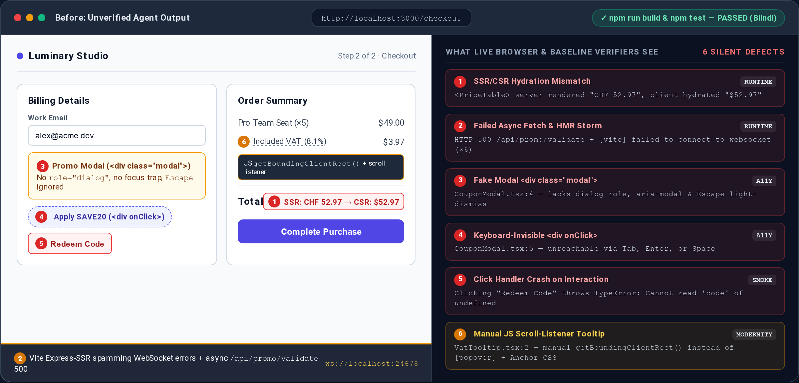
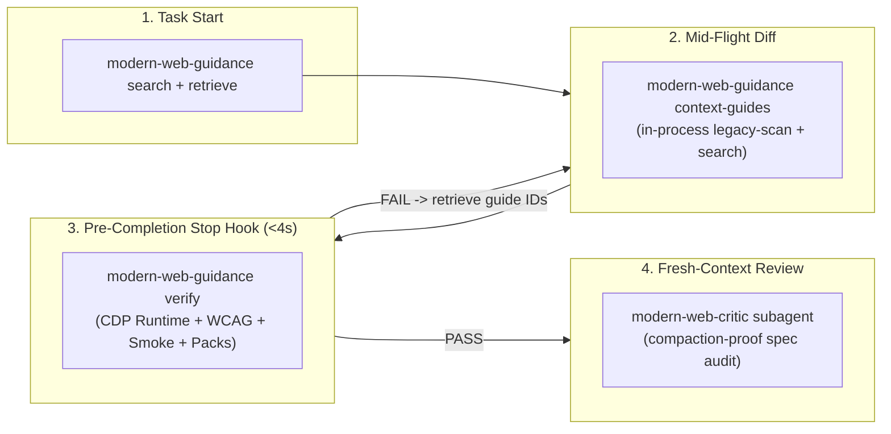
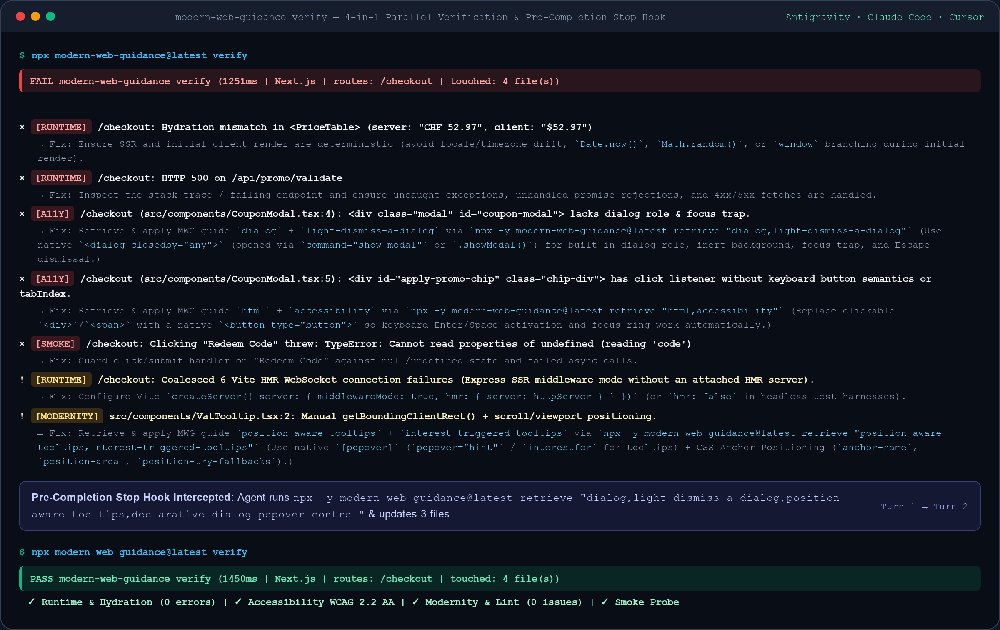
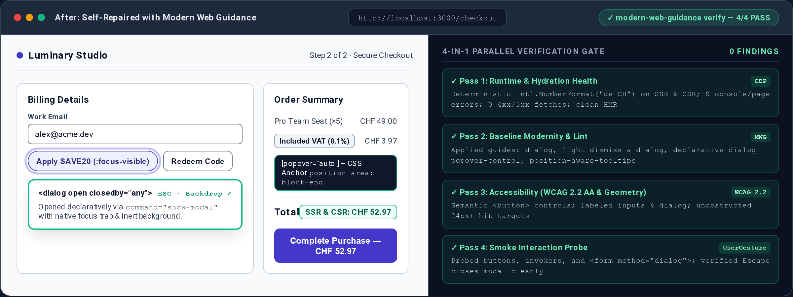

# Modern Web Guidance Verifier (`src/verifying`)

`src/verifying` pairs [Modern Web Guidance](../../guides) authoring retrieval (`search`, `retrieve`) and static legacy detection (`legacy-scan`) with sub-4-second live-browser verification and pre-completion agent lifecycle hooks. Every finding cites a verified guide ID from `gen/guides.json` and emits a copy-pasteable `npx -y modern-web-guidance@latest retrieve "<guide-ids>"` remediation command.



---

## 1. Closed-Loop Agent Lifecycle







---

## 2. CLI Commands

```bash
# 1. Live 4-in-1 parallel browser + static verification (<4s)
npx -y modern-web-guidance@latest verify [path] [--pack commerce|media|saas] [--perf] [--json]

# 2. Diff-aware guide resolver (combines git diff + touched files with legacy-scan & search)
npx -y modern-web-guidance@latest context-guides [path] [--include-content] [--json]

# 3. Install pre-completion Stop hook + compaction-proof modern-web-critic subagent
npx -y modern-web-guidance@latest install-hooks --target antigravity|claude|cursor|all [--dir <project>]
```

Locally inside `modern-web-guidance-src`, you can also invoke `node bin/gd.ts verify [path]` and `node bin/gd.ts context-guides [path]`.

---

## 3. Architecture (`src/verifying/`)

| Module | Responsibility |
| :--- | :--- |
| [`verify.ts`](./verify.ts) | Parallel orchestrator running the static pass concurrently with headless Chromium + dev-server boot (`Promise.allSettled` teardown guarantees). |
| [`browser-pass.ts`](./browser-pass.ts) | Single-pass CDP verification across touched routes: SSR/hydration mismatch diffing, Vite HMR noise coalescing, WCAG Tier-1 + rendered layout geometry (`zero-size-interactive`, `fixed-element-occlusion`) + optional `axe-core` WCAG 2.2 AA injection from the target workspace, CDP `DOMDebugger.getEventListeners` clickable-`<div>` detection, Fiber/Vue/Svelte/Astro source-line attribution, Smoke interaction + `Escape` focus-trap probing, and opt-in `--perf` telemetry (`long-animation-frame`, CLS, LCP, JS heap, detached DOM nodes, global `window`/`document` listener leaks). |
| [`static-pass.ts`](./static-pass.ts) | Runs `legacy-scan` (`src/analyzing/cli.ts`) in-process on touched files, supplemental checks (`MWG-TOOLTIP-POS`, `MWG-CLIPBOARD-EXECCOMMAND`, `MWG-LEGACY-100VH`), vertical pack static rules, and the target workspace's ESLint flat configuration if present. |
| [`packs.ts`](./packs.ts) | Auto-detected or explicit vertical packs (`commerce`, `media`, `saas`) enforcing domain UX contracts (autofill tokens, price/CTA layout shift, ad/sticky viewport occlusion, hero `fetchpriority`, semantic sortable `<th>`, and `Escape` focus restoration). |
| [`context-guides.ts`](./context-guides.ts) | Maps `git diff` + touched tokens to top relevant guide IDs via in-process `legacy-scan`, `searchUseCases`, and `getGuide`, plus bespoke-glue maintainability candidates. |
| [`stop-hook.ts`](./stop-hook.ts) | Universal pre-completion `Stop` hook supporting Google Antigravity, Claude Code, and Cursor JSON protocols with a `<15ms` web-diff pre-check and bounded retry caps. |
| [`critic-agent.ts`](./critic-agent.ts) | Exports non-destructive hook configs and the compaction-proof `modern-web-critic` subagent across `.agents/`, `.claude/`, and `.cursor/`. |
| [`cdp.ts`](./cdp.ts) | Zero-dependency multiplexed WebSocket CDP client and headless Chromium launcher. |
| [`discovery.ts`](./discovery.ts) | Framework/port detection, `git status` + `HEAD~1..HEAD` diff discovery, 3-hop reverse-import route resolution, and process-group dev-server management. |
| [`source-lexer.ts`](./source-lexer.ts) | Line-preserving JS/TS/JSX/SFC/HTML/CSS comment stripper and optional target-workspace ESLint runner. |
| [`reporter.ts`](./reporter.ts) | Token-budgeted terminal formatter linking findings to `modern-web-guidance retrieve`. |
